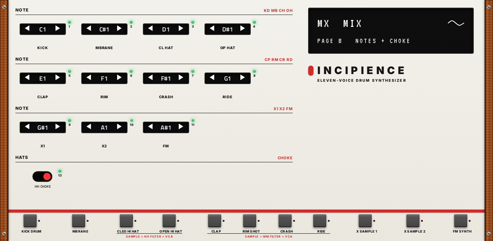

# Incipience

**Drum synth** · Eleven instruments laid out like the Jomox AlphaBase Mk II analog drum machine, with its controls and
0-127 ranges; plays the AlphaBase's own sample set. · maker in MPC: Steve A · written for this repo · licence: MIT
([`LICENSE`](LICENSE))


**Status (2026-10-13): phase 2.** The engine renders offline (phase 1); the MPC build and its screen are done and checked
offline (`tools/build.sh`: PASSED, `check_skin.py`: OK), not yet on a device. What's next is in
[ROADMAP.md](../../ROADMAP.md#new-plugins).

## What it is

The AlphaBase is an analog drum machine with eleven instruments. Incipience copies that structure and its controls,
and leaves out the sequencer: you play it from MPC's pads and sequencer.

| Instrument | On the AlphaBase | Here |
|---|---|---|
| KICK | Analog kick: VCO with a tune envelope, HARMONICS, a PULSE + NOISE attack shaped by GATE (0.1-15 ms), EQ, COMPRESS, a second pitch envelope, LFO | The same controls; a sine shaped towards pointed peaks, swept by the tune envelope |
| MBRANE | Two coupled filter oscillators (the Mod.Brane 11's), noise with its own envelope, two metal noises, pitch envelopes, two LFOs; the Mk II's 9 SCENES | Two resonant band-pass filters struck by the trigger pulse and the noise; DAMPEN up to self-oscillation; CPL 1>2 and CPL 2>1 (either sign) feed each other: same signs make them scream, opposite signs damp them |
| CL HAT, OP HAT | Sample + metal noise through the 2-pole hi-hat filter (LP, HP, peak), VCA ADSR, filter ADSR, LFO | The same chain; HH CHOKE (the Mk II): the two cut each other, and on the same step the open one wins |
| CLAP, RIM, CRASH, RIDE | Sample + metal noise through a 12 dB LP / HP / BP that self-oscillates from RESONANCE 85 | The same; with no sample it is an analog voice of its own (toms, claves) |
| X1, X2 | Digital sample players (and the AlphaBase's sampling input) | Sample players; no audio input in a plugin |
| FM | Four operators, a full 4x4 matrix with feedback, an attack-decay envelope per operator, up to six voices | The same; its own note plays CHORD |
| FX | Reverb and delay, a send per instrument | An 8-line reverb that rings on its own above ROOM 100; a ping-pong delay, free or synced to MPC's tempo |

It is not an emulation: the AlphaBase's circuits and firmware aren't published, so everything here is written from its
manual (what each control is said to do, its block diagrams and ranges), and it won't sound exactly like the hardware.
The metal noise patterns are this plugin's own; so are the MBrane's nine scenes and LFO waves 16-63 (with the
AlphaBase's `ABWV0300.raw` in the data folder, its own 64 LFO waves are used).

## The screen

Designed in Google Stitch to look like the AlphaBase Mk II's panel (cream, black knobs with green LEDs, wooden cheeks,
the OLED, the red band and the instrument keys). A tab per instrument, then FX and MIX; each tab has the hardware's two
pages as two Q-Link sub-pages (KICK A, KICK B, ...), with the controls of its 4 x 4 encoder matrix in the same places:
a row of the matrix is a panel and a Q-Link column (the hardware's display shows one row at a time). On the right of
each instrument: its MIX (pan, reverb and delay sends, mute) and its extras (the Mk II's synced LFO clock; the FM
synth's voices, chord, spatial and level), by touch.

| | A | B |
|---|---|---|
| KICK |  |  |
| MBRANE |  |  |
| CLAP (the others alike) |  |  |
| FM |  |  |
| FX |  |  |
| MIX |  |  |

How it's made: the Stitch design is one page, KICK A (`design/stitch-kick.html`, as Stitch wrote it); `mpc/design.py`
writes every page in its markup (`design/stitch.html`), the repo's `convert.py` turns that into the layout, and
`mpc/merge_ab.py` folds each tab's two pages into Q-Link sub-pages. `mpc/screen.sh` runs it all, through the build,
`check_skin.py` and these screenshots.

## Samples

The sample channels play the AlphaBase's samples by number, as its SAMPLE control does: sample `n` is `ABWV<nnnn>.raw`
(16-bit, 48 kHz, mono, no header) or `ABWV<nnnn>.wav` in the data folder. Jomox gives its sample set away
(`AlphaBaseWaves.zip` and `ABmk2Waves.zip` on jomox.de: the same 254 samples); they aren't shipped here. Without them
the built-in kits still play: they use the kick, the MBrane, metal noise through the filters, the self-oscillating
filters and the FM synth.

## Rendering offline

```
cc -O2 -Isrc mpc/render.c src/*.c -lm -lpthread -o build/render
build/render <data folder or ""> build/renders kit           # every kit: each instrument alone, then a groove
build/render <data folder or ""> build/renders script <file>  # one WAV per line: name;key=value;...;hits=kd@0,ch@0.5
```

`python3 mpc/gen.py` writes `params.json`, `src/params_def.h` and the page plan from one list (398 parameters).
