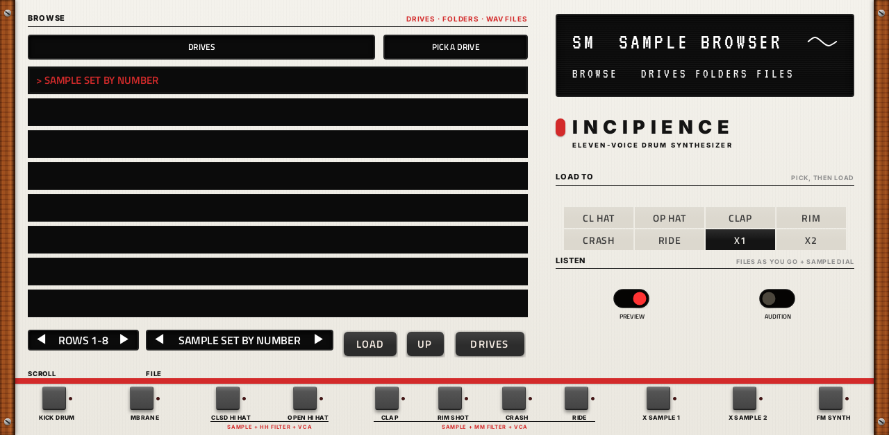

# Incipience

**Drum synth** · Eleven instruments laid out like the Jomox AlphaBase Mk II analog drum machine, with its controls and 0-127 ranges; plays the AlphaBase's own sample set and your own WAV files. · maker in MPC: Steve A · written for this repo · licence: MIT ([`LICENSE`](LICENSE))


**Status (2026-10-19): 1.0.0, the first release.** Played on an MPC Live II since 2026-10-13; everything below was
tried there by the owner by 2026-10-19. One thing still open: MPC's data wheel doesn't turn Incipience's controls (Q-Links and
touch do). What's next is in [ROADMAP.md](https://github.com/saustin2010/vst_instruments/blob/main/ROADMAP.md#new-plugins).

## On the MPC

- In the plugin browser: **[DRUM] Incipience** by **Steve A** (Drum Machine)
- Files: the release installs one folder, `/sdcard/Synths/Steve A - VST - [DRUM] Incipience/`, holding `incipience.so`, its screen. The vst_instruments installer puts `incipience.so` in `/sdcard/vst/` instead.
  and its screen.
- Data folder: `incipience/` next to `incipience.so` (with the vst_instruments installer, `/sdcard/vst/incipience/`):
  where the AlphaBase's samples go ([below](#samples)), and a `samples/` folder of your own if you like
- 730 parameters (all automatable) on 17 tabs: a tab per instrument with three Q-Link sub-pages, then FX, MIX, MOD,
  MIDI & OUT, MIDI MOD and SAMPLES
- 5 kits built in, in MPC's PRESET menu; 3 more with the AlphaBase's samples in the data folder
- **[FX] Incipience OUT** ([incipienceout](incipienceout/)) puts an instrument on a track of its own ([below](#outputs-out-1-11))

## What it is

The AlphaBase is an analog drum machine with eleven instruments. Incipience copies that structure and its controls,
and leaves out the sequencer: you play it from MPC's pads and sequencer.

| Instrument | On the AlphaBase | Here |
|---|---|---|
| KICK | Analog kick: VCO with a tune envelope, HARMONICS, a PULSE + NOISE attack shaped by GATE (0.1-15 ms), EQ, COMPRESS, a second pitch envelope, LFO | The same controls; a sine shaped towards pointed peaks, swept by the tune envelope |
| MBRANE | Two coupled filter oscillators (the Mod.Brane 11's), noise with its own envelope, two metal noises, pitch envelopes, two LFOs; the Mk II's 9 SCENES | Two resonant band-pass filters struck by the trigger pulse and the noise; DAMPEN up to self-oscillation; CPL 1>2 and CPL 2>1 (either sign) feed each other: same signs make them scream, opposite signs damp them |
| CL HAT, OP HAT | Sample + metal noise through the 2-pole hi-hat filter (LP, HP, peak), VCA ADSR, filter ADSR, LFO | The same chain; HH CHOKE (the Mk II): the two cut each other, and on the same step the open one wins |
| CLAP, RIM, CRASH, RIDE | Sample + metal noise through a 12 dB LP / HP / BP that self-oscillates from RESONANCE 85 | The same; with no sample it is an analog voice of its own (toms, claves) |
| X1, X2 | Digital sample players (and the AlphaBase's sampling input) | Sample players; no audio input in a plugin |
| FM | Four operators, a full 4x4 matrix with feedback, an attack-decay envelope per operator, up to six voices | The same; its own note plays CHORD |
| FX | Reverb and delay, a send per instrument | An 8-line reverb that rings on its own above ROOM 100; a ping-pong delay, free or synced to MPC's tempo |

It is not an emulation: the AlphaBase's circuits and firmware aren't published, so everything here is written from its
manual (what each control is said to do, its block diagrams and ranges), and it won't sound exactly like the hardware.
The metal noise patterns are this plugin's own; so are the MBrane's nine scenes and LFO waves 16-63 (with the
AlphaBase's `ABWV0300.raw` in the data folder, its own 64 LFO waves are used).

## The screen

Designed in Google Stitch to look like the AlphaBase Mk II's panel (cream, black knobs with green LEDs, wooden cheeks,
the OLED, the red band and the instrument keys). A tab per instrument, then FX and MIX. Each instrument has three
Q-Link sub-pages: the hardware's two pages (KICK A, KICK B), with the controls of its 4 x 4 encoder matrix in the same
places (a row of the matrix is a panel and a Q-Link column; the hardware's display shows one row at a time), and a
third (KICK MIX ...) whose Q-Links turn the panels on the right: the instrument's MIX (pan, reverb and delay sends,
mute) and its extras (the Mk II's synced LFO clock). On FM the third is FM VOICE: voices, chord, spatial and level
first, then its MIX and accent. FX has REVERB and DELAY (all the sends), MIX has PAN. Then MOD (its LFOs and 16
slots), MIDI & OUT (each instrument's NOTE, KEYS CH and OUT), MIDI MOD (each instrument's four lanes) and SAMPLES
(your own samples): below.

SAMPLE is a box with arrows: one sample a tap, and one a Q-Link tick or data-wheel click (since 1.0.0; it used to
skip two or three at a time). SCROLL on the SAMPLES tab moves one row a tick the same way. PITCH and CENTS on the sample
channels tune their metal noise as well as the sample (on the AlphaBase they move the sample alone), so a hat or a
cymbal without a sample can be tuned too; a tom from the self-oscillating filter is tuned with CUTOFF.

A sample goes through the channel's filter with its metal noise (ROUTING HH FILTER / LP / HP / BP), and at NOISE VOL's
full level the noise covers most samples: on CL HAT and CLAP at Init, stepping through the samples changes little until
NOISE VOL comes down (or METAL NZ goes OFF, or ROUTING OFF, the sample alone), and RIM's whistling filter (RESONANCE
above 85) rings over its sample the same way. NOISE VOL is on page A beside SAMPLE for that (since 2026-10-18; ENV
AMOUNT, and on the hats RESONANCE, moved to page B). The sample kits turn the metal noise off where they use samples.

**RANDOMISE**, by the name on each instrument's pages (touch only, on no Q-Link): a new sound from the instrument's own
controls, each within a range that keeps it a drum sound (gen.py's `RAND`): decays, filters, tunings, the sample (one
of the instrument's kind from the AlphaBase set: hats for the hats, cymbals for the cymbals), the metal noise, the LFO
(often off). Its VOLUME, ACCENT, MIX (pan, sends, mute), OUT, KEYS CH and lanes stay as they are, and so do the FM
synth's VOICES and CHORD. A roll always sounds: a hat or a cymbal left without a sample keeps a noise source through its
filter, and the FM synth keeps operator 1 in the mix. MPC's screen and Q-Links follow; there is no undo, so save the
kit you like (MPC's Program save keeps the plugin's state).

| | A | B | MIX / VOICE |
|---|---|---|---|
| KICK |  |  |  |
| MBRANE |  |  |  |
| CL HAT |  |  |  |
| CLAP (RIM, CRASH, RIDE alike) |  |  |  |
| X1 (X2 alike) |  |  |  |
| FM |  |  |  |
| FX |  |  | |
| MIX |  | | |
| MOD (LFO, MOD 1-4 ... 13-16) |  |  | |
| MIDI & OUT (NOTE, KEYS CH, OUT) |  |  |  |
| MIDI MOD (WHEEL, GP 1-3) |  |  | |
| SAMPLES |  | | |

## Playing it from MIDI tracks (as Percolator)

- **Pads:** each instrument plays on its NOTE as tuned (36-46 to start with: pads 1-11 of bank B on the plugin's own
  track); the FM synth's NOTE plays its CHORD. NOTE is on MIDI & OUT now (it was on MIX).
- **Chromatically (KEYS CH):** every note on an instrument's KEYS CH plays it pitched: C3 as tuned, an octave up at
  C4, and pitch bend on that channel bends it +-2 semitones. The kick and the MBrane transpose their oscillators, the
  sample channels their sample and their metal noise, X1 / X2 their sample; the FM synth plays a voice a note (up to
  its VOICES), with no chord. KEYS CH is channel 2 for KICK up to 12 for FM to start with; OFF; ALL (any note no NOTE
  takes). MPC hands the plugin's own track every note on channel 1, so the channels come through **Incipience MIDI
  In**, Incipience's own MIDI port: on a MIDI track, set MIDI OUTPUT PORT to Incipience MIDI In and the track's channel
  to the instrument's KEYS CH. (KEYS CH 1 makes the plugin's own track play that instrument from every pad.)
- **MIDI MOD lanes:** per instrument, the mod wheel and Gen Purpose 1-3 (CC 1 and 16-18; in a MIDI track's lane
  menu, MIDI 1 MOD WHEEL and MIDI 16-18 GEN PURPOSE 1-3) each set the control you pick for it, any of the instrument's
  own (all of them, its pan and sends too). On the instrument's KEYS CH, through Incipience MIDI In; KEYS CH ALL: on
  any channel. MPC's screen and Q-Links follow the control as the lane moves it.

## Outputs: OUT 1-11

MPC plays only a plugin's first stereo pair, so each instrument has an OUT: MAIN (Incipience's own mix) or OUT 1-11,
and **[FX] Incipience OUT** ([incipienceout](incipienceout/)), inserted on another track (an audio track will do),
plays one OUT there with that track's fader, inserts and output. To start with each instrument's OUT is its own (KICK
OUT 1 ... FM OUT 11), and an OUT nothing plays stays in the mix, so nothing changes until you insert the effect. An
instrument on a played OUT leaves Incipience's mix (its reverb and delay sends stay), panned and at the main VOLUME,
a block (2.9 ms) late, and Incipience holds its own output back by the same block.

## Modulation: the MOD tab

Four LFOs (WAVE: the AlphaBase's 64 shapes, 4 a sine; RATE; CLOCK free or synced to MPC's tempo; RESTART: free running,
or from the start at each hit of an instrument) and 16 slots. A slot moves one control: **SOURCE** (an LFO; RANDOM, a
new value at each hit of the slot's DEST; VELOCITY, of its DEST's last hit), **DEST** (an instrument, or FX: the reverb,
the delay and VOLUME), **CONTROL** (any of the DEST's controls, by name: the box with arrows) and **DEPTH** (+-100 % of
that control's range). Slots on one control add up, and a control never leaves its range. What the screen shows and the
project saves is the control as set; the slots move what the sound uses, every 32 samples. Controls a hit reads as it
starts (SAMPLE, START, STOP, LOOP, REVERSE, GATE, the FM envelopes) take the value of that moment; VOLUME, ACCENT, pan
and sends follow continuously. The LFOs and slots aren't part of a kit: a new kit keeps them, as it keeps the MIDI
settings.

What it costs: the instruments work out their settings every 32 samples anyway, so a slot adds a few multiplications;
offline, 60 s of all eleven instruments busy rendered in 0.48 s without slots and 0.46 s with all 16 on.

## Samples

The sample channels play the AlphaBase's samples by number, as its SAMPLE control does: sample `n` is `ABWV<nnnn>.raw`
(16-bit, 48 kHz, mono, no header) or `ABWV<nnnn>.wav` (16-bit PCM, any rate) in the data folder. Jomox gives its
sample set away, and it isn't shipped here: download
[`AlphaBaseWaves.zip`](https://www.jomox.de/upload/updates/AlphaBaseWaves.zip) (or the Mk II's
[`ABmk2Waves.zip`](https://www.jomox.de/upload/updates/ABmk2Waves.zip): the same 254 samples; both are under Updates on
the AlphaBase pages of [jomox.de](https://www.jomox.de)) and unzip it into the data folder, then insert Incipience
again. From a computer, with the release installed:

```
scp AlphaBaseWaves.zip root@<mpc-address>:/tmp/
ssh root@<mpc-address>
cd "/sdcard/Synths/Steve A - VST - [DRUM] Incipience" && mkdir -p incipience && cd incipience
unzip -o /tmp/AlphaBaseWaves.zip && rm /tmp/AlphaBaseWaves.zip
```

(With the vst_instruments installer the data folder is `/sdcard/vst/incipience/`, or unzip it into
`presets/incipience/` before running `install.sh`.) The files may also sit one folder down, as Windows' "Extract All"
leaves them (`incipience/AlphaBaseWaves/ABWV0000.raw ...`). The zip's `ABWV0300.raw` holds the AlphaBase's 64 LFO
waves, which then replace Incipience's own. Without the set the built-in kits still play: they use the kick, the
MBrane, metal noise through the filters, the self-oscillating filters and the FM synth.

## Your own samples: the SAMPLES tab

Any folder of WAV files on the MPC: its internal drive, an SD card, an SSD, a USB drive, or a `samples` folder you make
in the plugin's data folder (`incipience/samples/` next to `incipience.so`).

- **Browse:** DRIVES lists the places (SAMPLE SET BY NUMBER, INCIPIENCE SAMPLES if that folder is there, then the drives);
  tap one, then its folders (`.. UP` or the UP button goes back). Eight rows at a time: SCROLL (its Q-Link, or its
  arrows, a page a tap). FOLDER shows where you are (its end, if long: MPC shows 24 characters), the box beside it
  how many WAV files there are.
- **Load:** tap a WAV file: it loads into LOAD TO's instrument (CL HAT ... RIDE, X1, X2; X1 to start with) and, with
  PREVIEW on, plays once. A `>` marks the file LOAD TO's instrument plays.
- **Point to a folder:** after that, that instrument's SAMPLE shows the file's name and steps through the folder's WAV
  files in name order ("Kick 2" before "Kick 10"; the first 255), with its arrows or its Q-Link. RANDOMISE picks one of
  them, and a mod slot or a lane on SAMPLE spans them (+-100 % is the whole folder). SAMPLE SET BY NUMBER, at the top
  of the places, takes LOAD TO's instrument back to the AlphaBase set by number; so does loading a kit.
- **Files:** WAV, 8, 16, 24 or 32-bit or 32-bit float, any sample rate (played at its own pitch), stereo mixed to
  mono, the first minute, 64 MB a file at most. A file is read when something first asks for it (a hit, a tap, a step of
  SAMPLE), on a thread of its own, never the audio's: the hit that asks plays without it. 64 MB of files stay in memory;
  past that, the ones longest unplayed are let go (and read again when asked for), never one a voice is playing.
- **Saved:** the project keeps each instrument's folder and the file's name, and finds the file again by name (files
  added to the folder since don't matter). A folder that isn't there (a drive not plugged in) plays no sample until you
  load another. A folder changed on disk while the plugin is open shows its new files when you browse into it again.

The project's copy of the plugin's settings is now only what differs from the defaults (6 bytes for Init, 6.3 KB with
every control moved, in the wrapper's 8 KB, with room for the folders); projects saved before load as they did.

## Kits

In MPC's PRESET menu: **Init**, **Analog Basics**, **Low and Slow** (808-style kick, filter toms), **Hard Drive**
(909-style) and **Membranes**, which use no samples; with the AlphaBase's sample set in the data folder also **Sampled
House**, **Sampled Techno** and **Synth Filters** (its synth notes through the resonant filters), the kick and MBrane
still analog. The AlphaBase's own factory kits (its `ABPR0000.BIN`: 51 in the Mk I download, 62 in the Mk II's) need
its kit format decoded: not yet.

## Install

Needs a standalone MPC or Force on MPC OS 3.x with root SSH access (checked on an MPC Live II).

**From the release:** download `DRUM-Incipience-<version>-mpc-armv7.zip` from [Releases](https://github.com/saustin2010/mpc-vst-incipience/releases),
copy it to the MPC, unzip it and run `sh install.sh` in its folder as root. The installer stops MPC, backs up
`MPC.settings`, installs the plugin folder and starts MPC again; `INSTALL.md` in the zip has the details and a by-hand route.
Your own files in `incipience/` are kept when you update or uninstall.

**[FX] Incipience OUT** ([its README](incipienceout/)) has a zip of its own, `FX-Incipience-OUT-<version>-mpc-armv7.zip`,
in its own release on the same page (tag `incipience-out-v<version>`); install it the same way.

**With the rest of the collection:** from [vst_instruments](https://github.com/saustin2010/vst_instruments) ([INSTALL.md](https://github.com/saustin2010/vst_instruments/blob/main/INSTALL.md)):

```
./install.sh <mpc-address> incipience
```

Use one or the other for this plugin: both register the same plugin (same uid), so the last one run wins.

## How it's made

The engine (`src/`) is written for this repo from the AlphaBase's manual; `mpc/gen.py` writes `params.json`,
`src/params_def.h` and the page plan from one list. The screen: the Stitch design is one page, KICK A
(`design/stitch-kick.html`, as Stitch wrote it); `mpc/design.py` writes every page in its markup (`design/stitch.html`),
vst_instruments' `convert.py` turns that into the layout, and `mpc/merge_ab.py` folds each tab's pages into Q-Link
sub-pages. `mpc/screen.sh` runs it all, through the build, `check_skin.py` and the screenshots.

Offline renders, no MPC needed:

```
cc -O2 -Isrc mpc/render.c src/*.c -lm -lpthread -ldl -o build/render
build/render <data folder or ""> build/renders kit           # every kit: each instrument alone, then a groove
build/render <data folder or ""> build/renders script <file>  # one WAV per line: name;key=value;...;hits=kd@0,ch@0.5
```

`python3 mpc/gen.py` writes `params.json`, `src/params_def.h` and the page plan from one list (730 parameters; the
first 414 are as they were before 2026-10-17, the first 702 before 2026-10-18: MPC saves projects and Q-Links by
number).

`mpc/selftest.c` checks KEYS CH and pitch bend, the lanes, the matrix, RANDOMISE (40 rolls an instrument: in range,
the mix kept, every roll heard), your own samples (five kinds of WAV file written and read back, a folder's order, the
SAMPLES tab's browsing, a file loaded and played, found by name from the state, RANDOMISE and the matrix within the
folder, a kit back to the sample set, and 47 files of 1.8 MB played while another instrument holds one, past the 64 MB:
it runs clean under ASan/UBSan, which would catch a file freed under a voice, and TSan), the saved state's size (at
most 6.3 KB of the wrapper's 8 KB) and OUT 1-11 with Incipience OUT loaded as a library of its own (the comment at its
top says how to build and run it; `bench` times the matrix).

## Files

| Path | What |
|---|---|
| `screenshots/` | the pages as MPC draws them |
| `.github/workflows/release.yml` | the release build (GitHub Actions, a draft release) |
| `FRAMEWORK.md` | the changes to sd88me's tools this plugin is built with, and why |
| `deploy/` | ready to install: `vst/` → `/sdcard/vst/`, `Synths/` → `/sdcard/Synths/`, plus the plugin-list entry |
| `vst.json` | build settings: name, maker, sources, the kit list in the PRESET menu |
| `params.json` | the plugin's parameters as MPC sees them (VST index = order; append-only once released) |
| `layout.conf` | the screen: 17 tabs and their Q-Link sub-pages (generated) |
| `design/` | the Stitch design (`stitch-kick.html`) and every page in its markup (`stitch.html`, generated) |
| `images/stitch/` | artwork: page backgrounds and knob filmstrips (generated) |
| `src/`, `mpc/` | the engine, the generators, the self-test, the offline renderer |
| `incipienceout/` | [FX] Incipience OUT, which ships in this plugin's release |

## Building

With Docker (32-bit ARM emulation for the build), Python 3 and the tools from
[saustin2010/mpc-vst-plugins](https://github.com/saustin2010/mpc-vst-plugins/tree/steve-features) (sd88me's [mpc-vst-plugins](https://github.com/sd88me/mpc-vst-plugins)
plus changes offered to it, until they're merged there; the commit is the one in `.github/workflows/release.yml`, and [FRAMEWORK.md](FRAMEWORK.md) says which changes this plugin uses and why):

```
git clone -b steve-features https://github.com/saustin2010/mpc-vst-plugins
MPC_VST=$PWD/mpc-vst-plugins
bash "$MPC_VST/tools/build_port.sh" vst.json        # build/: incipience.so, the screen, the plugin-list entry
bash "$MPC_VST/tools/test_port.sh" vst.json         # the offline host test (ASan/UBSan): must print PASSED
```

Releases are built by GitHub Actions (`.github/workflows/release.yml`, "Release (draft)") as a draft, installed and checked
on a device, then published. More: [BUILDING.md](https://github.com/saustin2010/vst_instruments/blob/main/BUILDING.md), and to change the screen, [RESKINNING.md](https://github.com/saustin2010/vst_instruments/blob/main/RESKINNING.md).

## Development

This plugin is developed in [vst_instruments](https://github.com/saustin2010/vst_instruments) (`originals/incipience`), next to the other plugins
and the tools that made its screen, and published to [mpc-vst-incipience](https://github.com/saustin2010/mpc-vst-incipience) for its
releases. Issues and pull requests are welcome in either.
