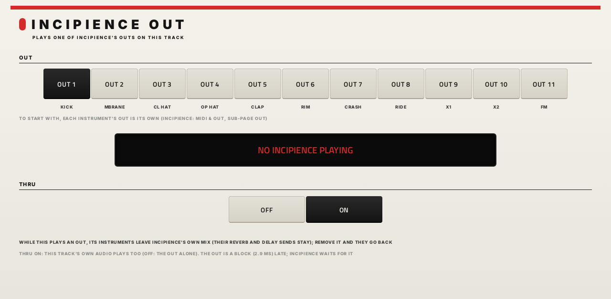

# Incipience OUT

**Audio effect** · Plays one of Incipience's OUT 1-11 on its own MPC track (an audio track will do), so an instrument gets that track's fader, inserts and outputs. · maker in MPC: Steve A · written for this repo · licence: MIT ([`LICENSE`](LICENSE)) · ships with [Incipience](../)

MPC plays only a plugin's first stereo pair (sd88me's test on a Force), so Incipience can't hand its instruments to
MPC's mixer as separate outputs. Instead, each Incipience instrument goes to **MAIN** or to **OUT 1-11** (its OUT, on
Incipience's MIDI & OUT tab, sub-page OUT), and this small effect, inserted on any other track, plays one OUT there.
It is [Percolator OUT](https://github.com/saustin2010/vst_instruments/tree/main/originals/percolator/percolatorout) made stereo and eleven wide: an audio track will do, so it
doesn't take an instrument plugin's place, and it costs next to nothing (it copies a block).

## Using it

1. **Incipience** on its track, as usual. Each instrument's **OUT** says where it goes: to start with, its own (KICK
   to OUT 1, MBRANE to OUT 2 ... FM to OUT 11); MAIN keeps an instrument in Incipience's own mix whatever plays. Several
   instruments can share an OUT.
2. On another track (an **audio track** is fine), insert **[FX] Incipience OUT** in an insert slot (MPC lists it
   under VST, with the other effects).
3. Pick the **OUT**. The display below says what's coming in: **KICK**, **CL HAT + OP HAT**, **NOTHING SENT TO OUT 5**,
   or **NO INCIPIENCE PLAYING**.

Those instruments now play on this track, with its fader, pan, inserts and output, and leave Incipience's own mix;
their reverb and delay sends still feed Incipience's effects (which stay on its track). Remove the effect, or pick
another OUT, and they go back to Incipience's mix within 16 blocks (46 ms). Until something plays an OUT, the
instruments sent there stay in Incipience's mix, so nothing goes quiet by accident.

- **THRU** (on to start with): the track's own audio plays too, so a recording on the audio track still sounds.
  Off: the OUT alone.
- **Stereo, as in the mix:** an instrument comes out panned (its PAN) and at Incipience's VOLUME, as it would have
  sounded in Incipience's mix; the FM synth keeps its SPATIAL width.
- **Timing:** the OUT is a block (2.9 ms) late; while something plays an OUT, Incipience holds its own output back by
  the same block, so the instruments stay together. (If MPC always ran this track before Incipience's, the OUT would
  settle two blocks late, one behind the rest; offline both orders work.)
- One Incipience per project feeds the OUTs: with two, the first that played.

## On the MPC

- In the insert effect slots: **[FX] Incipience OUT** by **Steve A**
- Files: `/sdcard/vst/incipienceout.so` and its screen in `/sdcard/Synths/Steve A - VST - [FX] Incipience OUT/`
- 3 parameters: OUT, THRU and STATUS (a readout); one page, OUT and THRU on Q-Link column 1
- Needs Incipience 1.0.0 or later in the same project
- Install: `FX-Incipience-OUT-<version>-mpc-armv7.zip` from [Incipience's releases](https://github.com/saustin2010/mpc-vst-incipience/releases)
  (tag `incipience-out-v<version>`), installed like Incipience's zip; or `./install.sh <mpc-address> incipienceout` from
  vst_instruments

## How it works

Incipience and this effect are separate libraries, so they share no memory of their own. Both map one region,
`/dev/shm/incipience-out-v1-<MPC's process id>` (about 360 KB, made by whichever starts first, removed by the next MPC
that starts after this one has gone), when they're created; Incipience writes each OUT into a stereo ring there and
publishes how far it has written, and this reads the block before that. Nothing is looked up or waited for while
playing, and no file stays open. The layout is in `src/tapbus.h`, which is the same file in both plugins
(`originals/incipience/src/tapbus.h`): change them together. Its version is part of the file's name, so two different
layouts never read each other; it is a different file from Percolator's, so the two never mix.

## Status (2026-10-19)

- Written for Incipience's OUT 1-11 (owner: "output routing for each of the tracks ... copy what's been done with
  percolator"). Offline (`mpc/selftest.c`): Incipience and this effect as two separately loaded libraries, on the Mac
  (`/tmp`) and in Linux (`/dev/shm`, under AddressSanitizer and UBSan): the effect plays exactly the kick, a block late
  (two if it always runs first), Incipience plays the rest; with no Incipience it goes quiet and says so.
- On the Live II since 2026-10-18 (owner: "other features look ok"). 1.0.0 ships in Incipience's 1.0.0 release.

## Files

| Path | What |
|---|---|
| `src/incipience_out.c` | the effect |
| `src/tapbus.h` | the OUT 1-11 bus (the same as Incipience's) |
| `mpc/gen.py` | writes `params.json`, `layout.conf` and the artwork's spec |
| `mpc/art.py` | draws the artwork (in the `mpc-vst-html-art` container) |
| `deploy/` | ready to install: `vst/` → `/sdcard/vst/`, `Synths/` → `/sdcard/Synths/`, plus the plugin-list entry |
| `images/skin/` | the artwork (generated) |
| `screenshots/` | the page as MPC draws it |

## Building

From the repo root: `tools/build.sh incipienceout` (see [BUILDING.md](https://github.com/saustin2010/vst_instruments/blob/main/BUILDING.md)). It lives in Incipience's
folder because it ships in Incipience's release (two zips, as TR-MPC ships its Tap FX).
