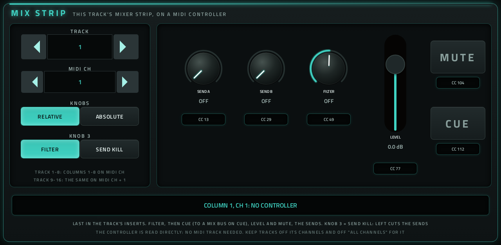
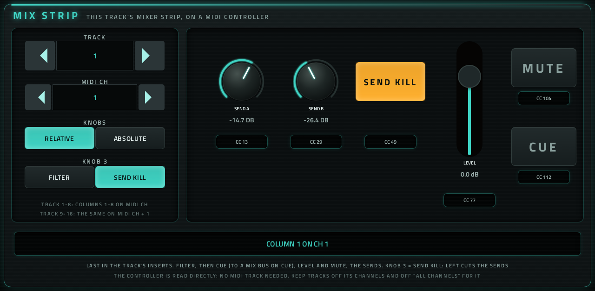

# Mix Strip

**Utility (insert effect)** · A mixer strip for one MPC track, played from a MIDI controller: LEVEL, MUTE, CUE, FILTER and two FX sends, with no MIDI learn and no MIDI track. · maker in MPC: Steve A · written for this repo · licence: MIT ([`LICENSE`](LICENSE)) · comes with **[Mix Bus](mixbus/)**, which plays the cue and the FX sends

With **KNOB 3** set to SEND KILL, the third knob cuts the sends instead of filtering:

Put Mix Strip last in a track's inserts and that track gets a column on your controller: three knobs (SEND A, SEND B,
and FILTER or SEND KILL, as the strip's KNOB 3 says), a fader (LEVEL) and two buttons (MUTE, CUE). Eight tracks fill a page of eight columns; tracks 9-16 are a
second page on the next MIDI channel. The controller is read straight from its USB port, so no MPC MIDI track or MIDI
learn is involved, and every move shows on the strip's screen (and should record as MPC automation like a Q-Link
turn: not checked on the device yet).

**[Mix Desk](mixdesk/)** (2026-11-07) puts the sixteen columns in one place: pick which MPC track each column plays,
and let its faders and MUTEs drive MPC's own track faders and Track Mutes (learned once, in a template). It can also
make every strip's second button a **SEND KILL** instead of CUE.

**CUE** is a pre-fader listen, as on a DJ mixer: a cued track plays on a **[Mix Bus](mixbus/)** set to CUE (on its own
audio track, routed to your headphones' output) whatever its LEVEL and MUTE. **SEND A / SEND B** feed Mix Buses set
to FX A / FX B, each with an effect after it, so one reverb or delay serves every track that sends to it.

## Using it

1. Set your controller to send the CCs below: page 1 (tracks 1-8) on one MIDI channel, page 2 (tracks 9-16) on the
   next. Knobs as relative encoders (binary offset) if it has them, faders absolute, buttons as toggles (127 on, 0 off).
   A controller with fader pickup (soft takeover) should have it on, so a fader waits until it meets the level.
2. On each track you want on the controller, insert **[UTIL] Mix Strip** in the **last** insert slot (a drum
   program's or a pad's inserts work too). A new strip takes the lowest **TRACK** no other strip has: insert them in
   track order and track 1 gets column 1, and so on. Change TRACK on its screen if you want another column.
3. Set **MIDI CH** to the channel page 1 sends on (a new strip takes the MIDI CH and KNOBS last set on another strip,
   so you set them once). If your knobs are ordinary pots, set **KNOBS** to ABSOLUTE. **KNOB 3** (per strip): FILTER,
   or SEND KILL to make the third knob cut this track's sends.
4. Leave MPC's own track fader at 0 dB: the strip's LEVEL is the level now.
5. For CUE or the sends, add a **[UTIL] Mix Bus** on an empty audio track ([Mix Bus](mixbus/)).
6. **Keep MPC tracks from listening to the controller on these channels**, or on "All channels": MPC still receives
   the controller as before, and CC 20-35 move every plugin's first-page Q-Links, so a track listening there would
   have its instrument moved too.

With a [Mix Desk](mixdesk/), set each strip's TRACK to the MPC track it's on: the desk says which column plays it,
and MIDI CH is the desk's.

The panel at the bottom says what the strip hears: **COLUMN 3 ON CH 1**, with a desk **DESK COLUMN 3 ON CH 6**,
**DESK COLUMN 3, LEVEL + MUTE ON MPC** or **TRACK 5 HAS NO COLUMN ON MIX DESK**, **COLUMN 3, CH 1: NO CONTROLLER** (nothing
plugged in), **TRACK 3 IS ON ANOTHER STRIP** (two strips on one TRACK: both follow the column, only the first feeds
the buses) or **CUE IS ON: ADD A MIX BUS ON CUE**. Under each control is the CC it answers to for this TRACK.

## The controller chart

Column *c* (1-8) of a page. Page 1 is tracks 1-8 on MIDI CH; page 2 is tracks 9-16, the same CCs on MIDI CH + 1.

| Control | CCs, columns 1-8 | Sends |
|---|---|---|
| SEND A (knob) | 13-20 | relative (binary offset: 65 = one step up, 63 = one down), or 0-127 with KNOBS = ABSOLUTE |
| SEND B (knob) | 29-36 | the same |
| FILTER or SEND KILL (knob, as KNOB 3 says) | 49-56 | FILTER: the same, with a detent at OFF (a relative knob stops at OFF on its way through and takes 8 counts to leave it; absolute, 60-68 is OFF). SEND KILL: turning left kills the sends, right brings them back (absolute: below 64 kills) |
| LEVEL (fader) | 77-84 | 0-127 |
| MUTE (button) | 104-111 | on at 64 and up, off below |
| CUE (button) | 112-119 | on at 64 and up, off below. With Mix Desk's BUTTON 2 = SEND KILL: on cuts the sends |

## The strip

In signal order:

- **FILTER**: off in the middle (from the controller it has a detent there, so it's easy to find); to the left a low-pass from 20 kHz down to 60 Hz, to the right a high-pass from
  10 Hz up to 8 kHz (12 dB per octave, a slight lift at the cutoff). The cutoff glides (25 ms) so a fast turn doesn't
  thump. Its value shows the cutoff (LP 1.2 kHz).
- **CUE** taps here: after the filter, before LEVEL and MUTE (it fades in and out over 5 ms).
- **LEVEL**: off at the bottom, **0 dB three-quarters up** (with a small detent), +6 dB at the top; -20 dB halfway
  to 0 dB. Shown in dB.
- **MUTE**: a 5 ms fade. The cue still hears a muted track.
- **SEND A / SEND B** tap after LEVEL and MUTE (post-fader): off at the left, 0 dB at the right, -20 dB halfway.
- **SEND KILL** (when KNOB 3 is SEND KILL; the filter is then off): cuts both sends with a 5 ms fade, so the effects'
  tails ring on; the track itself plays on. The screen's button does the same.

At 0 dB with the filter off and nothing muted the track's audio comes out bit for bit as it went in, and never later:
only the buses are late (see [Mix Bus](mixbus/)).

## On the MPC

- In the insert effect slots: **[UTIL] Mix Strip** by **Steve A**
- Files: `/sdcard/vst/mixstrip.so` and its screen in `/sdcard/Synths/Steve A - VST - [UTIL] Mix Strip/`
- 22 parameters: STATUS (a readout), TRACK, LEVEL, MUTE, CUE, FILTER, SEND A, SEND B, MIDI CH, KNOBS, a CC readout
  per control, the arrows of the TRACK and MIDI CH steppers, KNOB 3 and SEND KILL; one page, LEVEL / SEND A / SEND B /
  FILTER on Q-Link column 1, MUTE / CUE / TRACK / MIDI CH on column 2, KNOBS / KNOB 3 / SEND KILL on column 3
- Install: `./install.sh <mpc-address> mixstrip mixbus mixdesk` from this repo (new plugins: MPC restarts once). Not in
  sd88me's catalogue: Mix Strip, Mix Bus and Mix Desk are the owner's and are installed from this repo only (2026-11-18)

## How it works

Mix Strip and Mix Bus are separate libraries and every instance sits on its own track, so they meet in one region of
shared memory, `/dev/shm/mixstrip-v1-<MPC's process id>`, made by whichever instance starts first and removed by the
next MPC that starts after this one has gone (Percolator and Percolator OUT do the same). In it:

- **The controller table.** One instance at a time, Mix Strip or Mix Bus, is the listener: it opens an ALSA sequencer
  client ("Mix Strip" or "Mix Bus") with an input port nobody else can subscribe to, connects every controller's MIDI
  output to it (each USB MIDI device's readable ports, from `/proc/asound/seq/clients`, looked at again every 3 s;
  not the MPC's own ports or a port named "DAW"), and writes every Control Change into the table: per channel and
  CC, how many came, the last value and the running sum a relative encoder adds up to. Each strip reads its own six
  CCs from there at the start of each block. If the listener stops running blocks (removed, or its track bypassed),
  another instance takes over within 93 ms.
- **A slot per TRACK**, written by the strip that holds it: its CUE, SEND A and SEND B taps as stereo rings (1024
  frames), how far it has written, and its level and switches for Mix Bus's overview. A tap that's silent stops being
  written once its ring is silent.
- **What strips share**: the CUE bus's CUE MODE (SOLO turns other cues off) and the last MIDI CH and KNOBS set.
- **Mix Desk's settings** (layout version 2, 2026-11-07): which TRACK each column plays, MIDI CH, LEVEL + MUTE, BUTTON 2,
  and the fader it last sent MPC per TRACK (the sends follow it in MPC MIXER).

The controller's moves change the strip's own parameters (`mpc_engine_changed`, framework `eaef502`), so MPC's
screen and Q-Links follow and automation records them. The layout is in `src/mixshm.h` and the controller code in
`src/mixin.h`; both are the same files in Mix Bus (`mixbus/src/`): change them together (`test/run.sh` checks).

Files: `src/mixstrip.c` (the engine), `mpc/gen.py` (parameters, layout, artwork spec), `mpc/skin.py` (the artwork,
also Mix Bus's), `test/mix_test.c` (strips and buses together).

## Tests (2026-11-07: with Mix Desk, `test/run.sh` 127 checks PASSED, see [Mix Desk](mixdesk/))

## Tests (2026-10-25, offline)

- `tools/build.sh mixstrip mixbus`: PASSED (the 32-bit ARM `.so` and the framework's host test under ASan/UBSan).
- `test/run.sh`: strips and buses in one process, 90 checks, PASSED under ASan/UBSan: bit-for-bit pass-through at 0 dB,
  each control from the chart (relative and absolute knobs, page 2 on MIDI CH + 1), mute fade, CUE on the bus sample
  for sample one or two blocks later whichever runs first, SOLO and ADD, sends after LEVEL and MUTE, SEND KILL (sends
  silent, the dry sound untouched, back again), the filter's ends and its detent,
  one strip per TRACK, settings carried to new strips, state round trips.
- `check_skin.py`: OK. `dev-tools/displaydeps`: no parameter needs `refresh_display`.
- procwatch (TESTS.md): no flags; no threads, files or leaks. Native cost per block on the Mac about 6 µs (Percolator
  OUT, which only copies a block, 3.5 µs). It always runs (a strip has nothing to sleep through).

## Status

- 2026-11-07: [Mix Desk](mixdesk/) added (the owner: "all 8 channels in one place", volume and mute on MPC's own pages,
  "change the cue button to fx send mute/kill. I only need cue when I'm not using my MPC through the mixer"). Shared
  memory layout 2: install all three together. Installed on the Live II the same day (MPC restarted once).

- 2026-10-25: written from the owner's plan for a controller mixer (a cue selector that grew into a mixer); built
  and tested offline. Installed on the Live II the same day; the owner: "both are working well". The owner found
  the middle of FILTER hard to find on an endless knob: it now has a detent at OFF. Then asked for a send kill instead
  of the filter, chosen per strip: KNOB 3 = SEND KILL (both offline, tests PASSED). To check on the device: the listener finds the controller (STATUS), the moves reach
  the strips and record as automation, CUE on a Mix Bus, MPC doesn't list the plugin's port.
