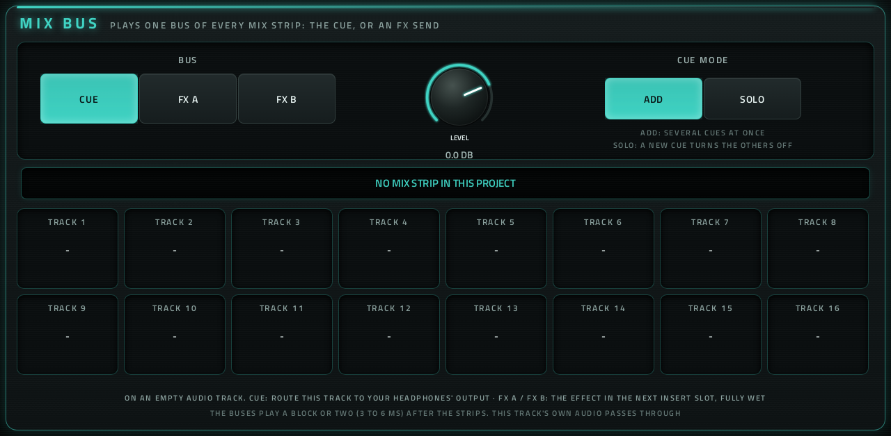

# Mix Bus

**Utility (insert effect)** · Plays one bus of every [Mix Strip](../) on its own MPC track: the CUE (pre-fader listen) for your headphones, or FX A / FX B, the strips' sends, into an effect. · maker in MPC: Steve A · written for this repo · licence: MIT ([`LICENSE`](LICENSE)) · ships with [Mix Strip](../)

Mix Strips are the tracks' channel strips; Mix Bus is where their CUE and their sends come out. Put it on an empty
audio track (MPC runs an audio track's inserts with nothing recorded on it, as Percolator OUT showed) and pick its
**BUS**:

- **CUE**: every strip whose CUE is on, before its LEVEL and MUTE. Route this track's output to the output your
  headphones listen to (on a DJ mixer, a channel with its fader down and its cue button on).
- **FX A / FX B**: every strip's SEND A or SEND B, after its LEVEL and MUTE. Put the effect (a reverb, a delay,
  Verglas...) in the next insert slot of the same track, fully wet: one effect serves every track that sends to it,
  and this track's fader, mute and output are the return's.

## Using it

1. Make an audio track (it can stay empty), insert **[UTIL] Mix Bus**, pick the **BUS**.
2. CUE: set the track's output to your headphones' output pair. FX A / FX B: add the effect after it.
3. **LEVEL** is the bus's own: off at the bottom, 0 dB three-quarters up, +6 dB at the top.
4. **CUE MODE** (on the CUE bus): **ADD** lets several cues play at once; **SOLO** means a new cue turns the others
   off, and the strips' CUE switches (and your controller, if it lights from its own presses) follow.

The panel says what plays: **CUE: TRACK 3 + 5**, **NOTHING CUED (8 STRIPS)**, **3 OF 8 STRIPS SEND TO FX A** or **NO
MIX STRIP IN THIS PROJECT**. Below it, every TRACK 1-16: its level, and MUTE / CUE / KILL (its sends killed) when
they're on (a dash: no strip on that TRACK).

- **Timing:** the buses play a block or two (2.9 to 5.8 ms) after the strips, which are never delayed. That's fine
  for a cue, a reverb or a delay; not for parallel compression (use MPC's own returns for that).
- Several Mix Buses can play the same BUS (two CUE buses on two outputs, say); CUE MODE comes from the last CUE bus to
  run a block.
- This track's own audio passes through, so it's harmless on a track that has audio.
- A Mix Bus also reads the controller for the strips when it's the first instance in the project ([Mix Strip](../),
  "How it works").

## On the MPC

- In the insert effect slots: **[UTIL] Mix Bus** by **Steve A**
- Files: `/sdcard/vst/mixbus.so` and its screen in `/sdcard/Synths/Steve A - VST - [UTIL] Mix Bus/`
- 36 parameters: STATUS (a readout), BUS, LEVEL, CUE MODE, then the overview's readouts (TRACK 1-16, TRACK 1-16 SW);
  one page, LEVEL / BUS / CUE MODE on Q-Link column 1
- Needs Mix Strip on the tracks; install the two together: `./install.sh <mpc-address> mixstrip mixbus`

## How it works

See [Mix Strip](../) ("How it works"): the strips write their taps into rings in shared memory, and each Mix Bus
reads its BUS from every TRACK's ring the way Percolator OUT reads an OUT (the block before the last one written,
whichever of the two ran first in a period) and adds them up. `src/mixshm.h` and `src/mixin.h` are the same files as
Mix Strip's (`../src/`). Files: `src/mixbus.c` (the engine), `mpc/gen.py` (parameters, layout, artwork spec; the
artwork is drawn by Mix Strip's `mpc/skin.py`).

## Tests and status

- 2026-10-25: built and tested offline with Mix Strip (`tools/build.sh mixbus` PASSED, Mix Strip's `test/run.sh`
  PASSED, `check_skin.py` OK, procwatch no flags). Installed on the Live II the same day; the owner: "both are working well".
- 2026-11-07: with a [Mix Desk](../mixdesk/) on MPC MIXER, the overview shows a track's level as ON MPC and its MUTE as
  the desk last sent it to MPC. Shared memory layout 2 (install with mixstrip and mixdesk).
