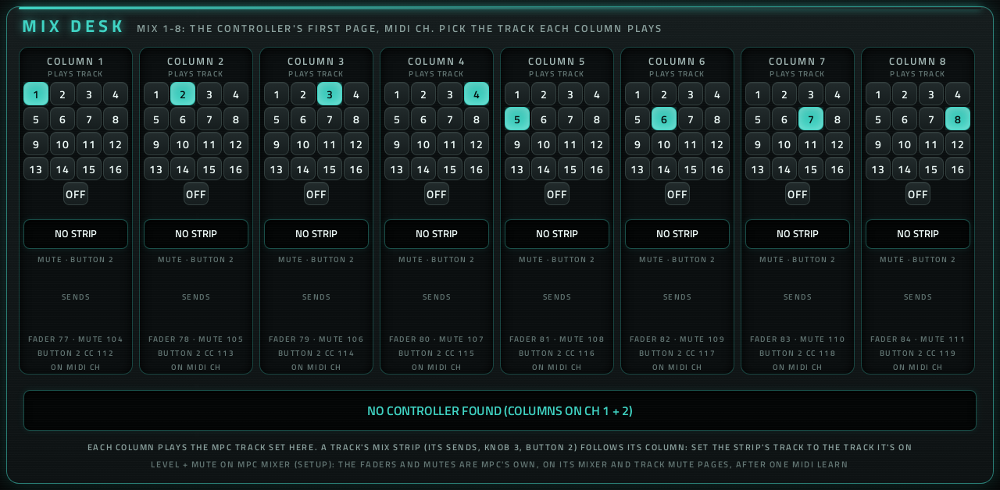
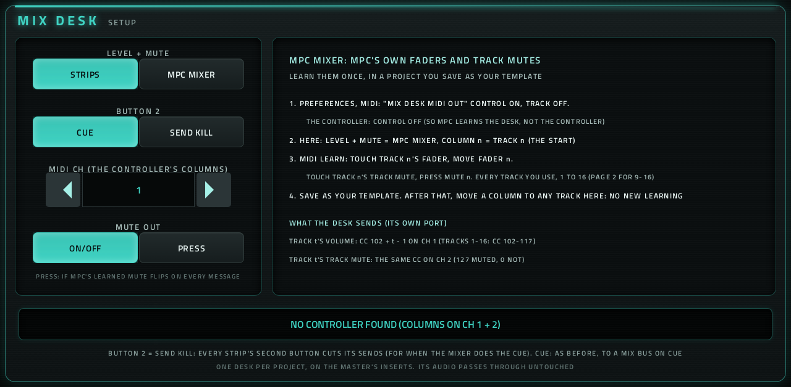

# Mix Desk

**Utility (insert effect)** · The controller's sixteen mixer columns (two pages of eight) in one place: pick which MPC
track each column plays, and let the faders and MUTEs drive MPC's own track faders and Track Mutes. · maker in MPC: Steve A · written for
this repo · licence: MIT ([`LICENSE`](LICENSE)) · part of **[Mix Strip](../)**'s family, with [Mix Bus](../mixbus/)

(MIX 9-16, the second page, is the same for columns 9-16: [screenshots/page_1.png](screenshots/page_1.png).)

Without a desk, a [Mix Strip](../)'s column is its TRACK. With one, the desk says which MPC track (1-16, or OFF) each
of the sixteen columns plays (tap the track in the column's grid): columns 1-8 are the controller's page on MIDI CH,
9-16 the page on MIDI CH + 1. Every strip follows it. Its screen shows each column's level,
MUTE, CUE or KILL and sends.

**LEVEL + MUTE** (on SETUP):

- **STRIPS**: the strips do them, as they do with no desk.
- **MPC MIXER**: the desk sends each column's fader and MUTE from its own MIDI port, **Mix Desk MIDI Out**, as fixed
  CCs per MPC track, which you tie to MPC's track faders and Track Mutes once with MPC's MIDI Learn, in a project you
  save as your template. The levels and mutes are then MPC's own, on its mixer and Track Mute pages, and a track
  without a strip can be on a column too. Moving a column to another track is done on the desk: no new learning.
  Nothing is sent until a fader or button moves, so loading a project or moving a column doesn't jump any level.
  The strips leave their LEVEL and MUTE alone in this mode (0 dB, never muted), and their sends follow the fader the
  desk last sent for their track, so a fader pulled down takes its sends with it (MPC's fader comes after the strip,
  so the strip can't hear it).
  - MPC's Track Mute stops a track's notes, so a CUE can't play a track muted this way.

**BUTTON 2**: **CUE** (as before), or **SEND KILL**: every strip's second button cuts its sends (the dry sound plays
on, the effects' tails ring out). For when your mixer does the cue.

**MUTE OUT**: **ON/OFF** sends 127 for muted and 0 for not. **PRESS** sends a press (127 then 0) for every button
message, if MPC's learned mute flips on each message instead. The desk can't read MPC's mute, so with PRESS the desk's own MUTE display can be wrong.

## Setting it up

1. Insert **[UTIL] Mix Desk** on the master's inserts (one per project; it passes its audio through untouched). A
   second desk waits and says so.
2. **MIDI CH**: the channel the controller's page 1 sends on (it starts on the one your strips use).
3. Each track you want sends, KNOB 3 or BUTTON 2 on: a [Mix Strip](../) last in its inserts, with its **TRACK set to
   the MPC track it's on**. A track that only needs its fader and mute (MPC MIXER) needs no strip.

**MPC MIXER, once, in your template project**:

1. MPC's MIDI preferences: **Mix Desk MIDI Out**: Control on, Track off. The controller: Control off, so MPC
   learns the desk's messages and not the controller's own.
2. On the desk: LEVEL + MUTE = MPC MIXER, column *n* = track *n* (as it starts).
3. MPC's MIDI Learn: touch track *n*'s fader, move fader *n*; touch track *n*'s Track Mute, press MUTE *n*; for every
   track you use, 1 to 16 (tracks 9-16 from the controller's second page).
4. Save the project as your template.

| The desk sends | on |
|---|---|
| MPC track *t*'s volume: the column's fader, 0-127 | CC 101 + *t* (tracks 1-16: CC 102-117), MIDI channel 1 |
| MPC track *t*'s Track Mute: 127 muted, 0 not (PRESS: 127, 0) | the same CC, MIDI channel 2 |

It reads the controller's columns as the strips do (the chart is in [Mix Strip](../)'s README): fader CC 77-84,
MUTE CC 104-111, BUTTON 2 CC 112-119, columns 1-8 on MIDI CH and 9-16 on MIDI CH + 1.

## On the MPC

- In the insert effect slots: **[UTIL] Mix Desk** by **Steve A**
- Files: `/sdcard/vst/mixdesk.so` and its screen in `/sdcard/Synths/Steve A - VST - [UTIL] Mix Desk/`
- 71 parameters: STATUS, LEVEL+MUTE, BUTTON 2, MIDI CH, MUTE OUT, COLUMN 1-16, MIDI CH's arrows, and three readouts per
  column. Three pages: MIX 1-8 and MIX 9-16 (Q-Links: their COLUMNs), SETUP (Q-Links: LEVEL+MUTE, BUTTON 2, MIDI CH,
  MUTE OUT)
- Install: `./install.sh <mpc-address> mixstrip mixbus mixdesk` (all three: they share memory layout 2; a new
  plugin, so MPC restarts once)

## How it works

The desk meets the strips in their shared memory (`src/mixshm.h`, the same file in all three plugins, layout version
2): it publishes which track each column plays, MIDI CH, LEVEL + MUTE and BUTTON 2, and each TRACK's last fader and
mute sent to MPC. Its MIDI port (`src/mixout.h`), a way of sending proven on the Live II, is an ALSA client "Mix Desk"
whose output port MPC lists as an input. It can be the instance that reads the controllers
too (`src/mixin.h`).

## Tests (2026-11-07, offline)

- `tools/build.sh mixstrip mixbus mixdesk`: PASSED. `check_skin.py`: OK. `dev-tools/displaydeps`: none needed.
- `../test/run.sh`: 127 checks PASSED under ASan/UBSan (37 for the desk): columns swapped move the right strips, page
  2 (MIDI CH + 1) reaches track 9 on any of its columns, a track with no column says so, MPC MIXER sends the right CC per track (fader, mute, PRESS), the strip passes bit for
  bit with its own LEVEL at 0 and MUTE on, sends silent with the fader down and at 0 dB at 95, BUTTON 2 = SEND KILL
  (cue turned off, sends cut, dry untouched), an OFF column sends nothing, a second desk waits and takes over, state
  round trip, strips back to their own columns and LEVEL when the desk goes.

## Status

- 2026-11-07: written for the owner ("all 8 channels in one place and I can allocate which track I want on which
  channel"; mute and volume on MPC's own pages: they chose MIDI Learn once, in a template). First built for tracks
  1-8 on one page, then two pages as the owner laid out their tracks: drums 1-4, bass 5-6, keys 7-8 on page 1;
  samples 9-10 and external MIDI or spare tracks 11-16 on page 2. Not installed. To check on the device: MPC lists Mix Desk MIDI Out and learns from it (Control on), the
  learn survives in a template, ON/OFF or PRESS for a learned Track Mute, MPC's track fader comes after the inserts
  (the cue doesn't follow it), a learned control records as automation.
