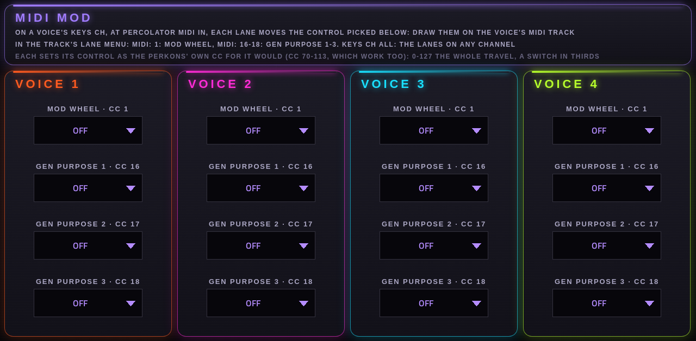
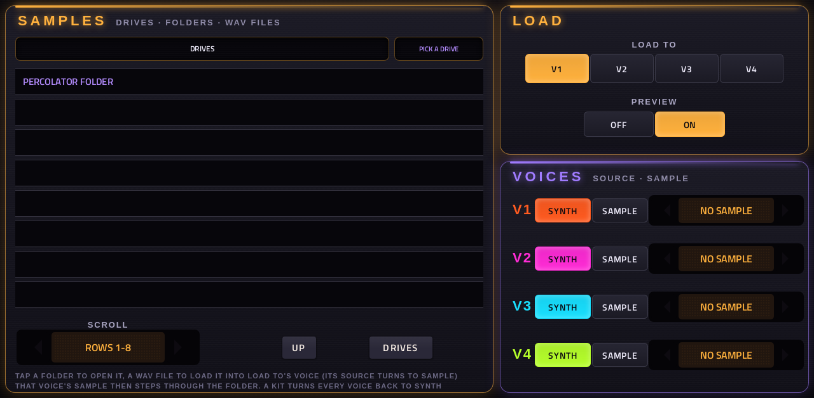

# Percolator

**Drum synth** · Four-voice percussion synth laid out like the Erica Synths Pērkons HD-01, with envelope displays; it plays the Pērkons' free kit packs. · maker in MPC: Steve A · written for this repo · licence: MIT ([`LICENSE`](LICENSE))


The Pērkons HD-01 is a four-voice hybrid drum machine: a digital engine per voice, then an analogue HP/BP/LP filter
and an overdrive, a BBD-style delay, a compressor and one LFO that can reach every knob. Percolator copies that
architecture and its panel (each voice has TUNE, DECAY, PARAM 1, PARAM 2, CUTOFF, DRIVE, FX SEND and LEVEL, plus ALGO,
MODE and VCF switches), and leaves out the sequencer: you play it from MPC's pads and sequencer.

**It is not an emulation.** The Pērkons firmware is a compiled binary for its own chip, and its DSP can't be read out
of it, so every algorithm here is written from scratch. The algorithm and parameter names follow the published
manuals for the HD-01 and the Perkons Voice module. A kit from a Pērkons pack keeps its structure (which algorithm,
which mode, where each knob is, the LFO, the delay), but it won't sound exactly like the hardware.

## On the MPC

- In the plugin browser: **[DRUM] Percolator** by **Steve A** (Drum Machine)
- Files: the release installs one folder, `/sdcard/Synths/Steve A - VST - [DRUM] Percolator/`, holding `percolator.so`, its screen. The vst_instruments installer puts `percolator.so` in `/sdcard/vst/` instead.
- Data folder: `percolator/` next to `percolator.so` (with the vst_instruments installer, `/sdcard/vst/percolator/`):
  where the kit packs go
- Your own WAV files on any voice, from the MPC's drives (the SAMPLES page, [below](#your-own-samples-on-every-voice));
  a RANDOMISE button per voice ([below](#randomise))
- 183 parameters (all automatable) on 10 pages, one Q-Link page each
- 8 kits built in, in MPC's PRESET menu; Erica Synths' four free Pērkons kit packs add 169 more ([below](#pērkons-kit-packs))

## Playing it

Each voice's MIDI is set on the **MIDI & OUT** page:

- **NOTE**: the note that plays it, as tuned. To start with **36-39 (C1-D#1)** for voices 1-4, the usual drum notes
  (a Force's drum pads, TR-MPC); on an MPC plugin track those are pads 1-4 of **bank B**. Give two voices the same
  note and they play together. (Up to 1.2.0 the notes were fixed at 20-23, bank A: a sequence recorded on those needs
  moving, or set the NOTEs to G#-1, A-1, A#-1, B-1.)
- **KEYS CH**: the MIDI channel on which every note plays the voice **pitched** (C3 = as tuned), with that channel's
  pitch bend (±2 semitones). To start with **channels 2-5 for voices 1-4**: the Pērkons' MULTI mode, always on. Two
  voices on one KEYS CH play together. **OFF**: never pitched. **ALL**: every note that isn't a voice's NOTE, on any
  channel (the KEYS switch up to 1.2.0; a project saved then gets ALL on its KEYS voice). On its KEYS CH a voice takes
  every note, its own NOTE too; on other channels its NOTE plays it as tuned.

  **The channels come in through Percolator's own MIDI port**, as they would to a hardware Pērkons: MPC hands a plugin
  on its track every note-on on channel 1, whatever channel it was sent on (traced on a Live II), so the track can't
  carry them. Percolator opens a MIDI input port that MPC lists as **Percolator MIDI In** (a second Percolator:
  Percolator 2 MIDI In). To play voice 2 from a MIDI track: that track's **MIDI OUTPUT PORT** = Percolator MIDI In,
  **MIDI OUTPUT CH** = 3. A track per voice, or one track whose notes carry their channels. The pads and the notes on
  Percolator's own track still play the kit (they arrive on channel 1). Don't also route that MIDI track into
  Percolator's track, or each note plays twice.
- **MIDI MOD lanes** (their own page): four per voice, **MOD WHEEL** (CC 1) and **GEN PURPOSE 1, 2, 3** (CC 16-18),
  as MPC names them in a MIDI track's lane menu ("MIDI: 1: ...", "MIDI: 16: Gen Purpose 1"). Each picks by name the
  control it moves: OFF (to start with) or any of the voice's eleven (TUNE ... LEVEL, ALGO, MODE, VCF). A lane counts
  on the voice's KEYS CH (any channel for ALL), so the MIDI track that plays a voice through Percolator MIDI In draws
  up to four lanes, say DECAY, CUTOFF, DRIVE and ALGO, without a CC number to look up. Each sets its control as that
  control's Pērkons CC would (below); the screen follows. Voices on one channel each move their own.
- **MIDI CCs, as on the Pērkons HD-01** (its chart, [midi.guide](https://midi.guide/d/erica-synths/perkons-hd-01/)):
  each voice's eleven controls, its knobs and its three switches, on any channel (the number says which voice). The
  screen and the Q-Links follow. Through **Percolator MIDI In**, so the MIDI track that plays a voice can carry that
  voice's moves in its CC lanes; on Percolator's own track too, except CC 98 and 99 (voice 3's FX SEND and LEVEL),
  which the framework keeps there as NRPN.

  | | TUNE | DECAY | PARAM 1 | PARAM 2 | CUTOFF | DRIVE | FX SEND | LEVEL | ALGO | MODE | VCF |
  |---|---|---|---|---|---|---|---|---|---|---|---|
  | Voice 1 | 70 | 71 | 72 | 73 | 74 | 75 | 76 | 77 | 78 | 79 | 80 |
  | Voice 2 | 81 | 82 | 83 | 84 | 85 | 86 | 87 | 88 | 89 | 90 | 91 |
  | Voice 3 | 92 | 93 | 94 | 95 | 96 | 97 | 98 | 99 | 100 | 101 | 102 |
  | Voice 4 | 103 | 104 | 105 | 106 | 107 | 108 | 109 | 110 | 111 | 112 | 113 |

  0-127 covers a knob's whole travel; TUNE's 64 is its middle. A switch takes thirds: 0-42 the first position
  (ALGO 1, MODE 1, VCF HP), 43-85 the second, 86-127 the third. (Which end of the Pērkons' own filter switch is HP
  isn't in its chart: here the order is the screen's.) The delay and compressor have no CCs, as on the Pērkons; MIDI
  CC 20-35 move the MASTER page's Q-Links instead (below).
- Velocity sets the level.
- **DECAY at the top = DRONE**: the voice sounds for as long as its note is held, then fades in 0.35 s (on the
  hardware a drone never stops; here the note length decides).
- CC 120 (all sound off) and 123 (all notes off) stop everything. MIDI CC 20-35 move the first page's (MASTER's) Q-Links, and
  NRPN reaches any parameter (the wrapper's, as in every plugin here).

## The voices

| Voice | ALGO 1 | ALGO 2 | ALGO 3 |
|---|---|---|---|
| **1** (low, 12 Hz-770 Hz) | **FOLD**: sine through a wavefolder. P1 fold, P2 pitch envelope. Modes: clean, noise hit, pulse hit | **WAVE**: wavetable. P1 position, P2 pitch envelope. Modes: analog, formant, digital tables | **RES BD**: a pitched resonator struck like an 808. P1 pitch-envelope time, P2 pitch envelope. Modes: soft, punch, hard |
| **2** (mid, 25 Hz-2.3 kHz) | **FOLD** (as voice 1) | **WAVE** (as voice 1) | **FM**: two operators. P1 FM amount and ratio, P2 pitch envelope. Modes: sine, triangle, square modulator |
| **3** (snare) | **SNARE**: two resonators and filtered noise. P1 noise tone, P2 noise decay. Modes: classic, tight, metallic | **SLAP**: a clap, bursts of band-passed noise and a tail. P1 reverb, P2 filter. Modes: 3, 4 or 5 claps | **TOM**: a resonator with self-FM. P1 FM, P2 tone (click). Modes: flat, drop, deep drop |
| **4** (metal) | **NOISE**: P1 reverb, P2 attack. Modes: white, pulse stack (six square waves, 808 hat), crush | **METAL**: P1 reverb (PCM: size), P2 attack. Modes: cymbal, bell (FM), PCM noise | **SAMPLE**: three slots. P1 crush (sample rate and bits), P2 attack, or start/slice with a pack's samples. Modes: sample 1-3 |

PARAM 1 and PARAM 2 rename themselves on the MPC as the algorithm changes ("V1 FOLD", "V3 NOISE DECAY"), and TUNE,
DECAY, CUTOFF and the time-like params show their real units (Hz, ms, octaves, slice 3 / 8). The selected mode's name shows in
the panel's title bar.

After the engine, every voice has the same end: the filter (HP / BP / LP, 20 Hz-20 kHz, no resonance control, like
the hardware's), the overdrive, then LEVEL, the FX SEND to the delay and the COMP SEND to the compressor.

**Voice 4's samples.** Without a pack, the three slots hold a closed hat, an open hat and a ride, synthesised at
start-up. A pack that comes with `SAMPLES/1.wav 2.wav 3.wav` (Pērkons pack 2 and 4) replaces them for its own kits.
Then PARAM 2 picks the start point or, when the WAV has cue points (pack 4's breaks), the slice. On the Pērkons this
needs two settings (Voice 4 / Algo 3 PARAM 2 = start, slicing on); here it follows from the pack having samples.

## Your own samples on every voice

Since 2.1.0 any voice can play a WAV file instead of its algorithm (owner, 2026-10-19: on the Pērkons only voice 4
plays samples, "but I think they should be allowed on each voice"):

- **SOURCE** (each voice page, at the top beside RANDOMISE): **SYNTH**, the voice's algorithm as before, or **SAMPLE**, its
  own file, played as voice 4's SAMPLE algorithm plays its slots: **TUNE** is its pitch (±2 octaves, the middle as
  recorded), **DECAY** its envelope, **PARAM 1** reads **CRUSH** (sample rate and bits), **PARAM 2** reads **START**, or
  **SLICE** when the file has cue points; then the voice's own filter, drive, LEVEL and sends, its NOTE, KEYS CH
  (pitched), OUT, lanes and LFO depths, as ever. ALGO and MODE wait meanwhile (the readout under MODE says
  ALGO OFF: SAMPLE).
- **SAMPLE** (beside CUTOFF and DRIVE, level with them): the file's name (a long one, its start and end); its arrows,
  the data wheel (tap the box first) or its Q-Link step through the WAV files of its folder in name order ("Kick 2"
  before "Kick 10"; the first 255), a file a click. NO SAMPLE until you load one.
- **Loading one: the SAMPLES page**, the same browser as Incipience 1.1.0's (owner, 2026-10-20: "I want the same
  browser in percolator"; how it works: [docs/sample-browser.md](../../docs/sample-browser.md)). **DRIVES** lists the
  places: **PERCOLATOR FOLDER** (the data folder, where the kit packs are, each with its `SAMPLES/` folder), then the
  MPC's drives (INTERNAL, SD cards, SSDs, USB drives). A folder lists its own WAV files, then every subfolder's, each
  under a heading with its path (`Kicks/Room /`), so the wheel goes through them all; tap a heading for that folder
  alone (a folder holding too much for one list, as a drive's top level often does, lists its subfolders instead).
  `.. UP` or **UP** goes back.
  - **The cursor (FILE):** its row framed in amber, its name in the FILE box. **Tap the FILE box, then turn the data
    wheel**: a file a click, over the headings, from one folder into the next. Tapping rows leaves the wheel on FILE.
    **Q-Link 1 (BROWSE)** moves it too, a file per three Q-Link events (a small turn of a Live II Q-Link is several);
    **SCROLL** (Q-Link 2, or its arrows) a page.
  - **PREVIEW** (on to start with): the file the cursor lands on plays straight from the drive, until it ends or the
    cursor moves.
  - **Loading:** tap a file to put the cursor there and hear it; **tap it again, or LOAD**, and it loads into
    **LOAD TO**'s voice (V1 to start with), whose SOURCE turns to SAMPLE (with PREVIEW on, the voice plays it once).
    **AUTO LOAD** (off to start with): the file the cursor lands on loads at once, so the wheel alone browses and
    loads. A `>` marks the file LOAD TO's voice plays; picking a voice in LOAD TO puts the cursor on its file (the list
    goes to its folder if needed).
  - **AUDITION** (off to start with): turning a voice's SAMPLE plays it once (on SOURCE = SAMPLE).
  - The box at the top shows where you are (the cursor's file's folder; its end, if long), the one beside it how much is
    listed (`64 WAVS IN 5 FOLDERS`). On the right, each voice's SOURCE and SAMPLE again (Q-Link columns 3 and 4).
- **A kit** (the PRESET menu, KIT) turns every voice back to SYNTH, the kit's sound; each keeps its file, so SOURCE =
  SAMPLE plays it again.
- **Files:** WAV, 8, 16, 24 or 32-bit or 32-bit float, any sample rate (played at its own pitch), up to 8 channels
  mixed to mono, the first minute, 64 MB a file at most, cue points as slices (as the kit packs'). A file is read when
  something first asks for it (the cursor landing on it, a load, a step of SAMPLE, a hit), on a thread of its own, never the audio's: a hit that
  asks plays without it. 64 MB of files stay in memory; past that the ones longest unplayed are let go (and read again
  when asked for), never one a voice is playing.
- **Saved** with the project: each voice's folder and the file's name, found again by name when the project opens
  (files added to the folder since don't matter); a folder that isn't there (a drive not plugged in) plays no sample
  until you load another. A folder changed on disk while Percolator is open shows its new files when you browse into
  it again. A project saved with 2.0.1 or before opens with every voice on SYNTH.

## RANDOMISE

A button at the top of each voice page (a tap; not on a Q-Link) rolls that voice's sound: **ALGO, MODE, TUNE, DECAY,
PARAM 1, PARAM 2, VCF, CUTOFF and DRIVE**, each in a range that keeps it a drum of its kind. DECAY never reaches DRONE,
and the filter is set by where the sound is (its pitch and pitch sweep, WAVE's formant, voice 4's noise and partials):
a low-pass an octave or more above it, a band-pass on it (voices 1-3), a high-pass below it. On **SOURCE = SAMPLE** it
picks a file of the voice's folder, its pitch, start (or slice), crush and filter instead of the algorithm's. Left as
they are: **LEVEL, FX SEND, COMP SEND**, NOTE, KEYS CH, OUT, the MIDI MOD lanes, the LFO depths and SOURCE. MPC's
screen and Q-Links follow each change. Every roll is heard: 20,000 a voice offline each peak over -36 dBFS, all but
about 1 in 10,000 over -30 (the built-in kits' softest voice peaks at -27).

## The compressor

Each voice's **COMP SEND** sets how much of it goes through the compressor (wet) and how much goes past it (dry); the
delay's echoes always go past it. 100 (all of it, as before 2.0.0) by default. On the MASTER page, **COMP THRESH**
sets the threshold (0 to -36 dB) and **COMP AMOUNT** the ratio (1:1 to 10:1). AMOUNT at 0 reads **OFF**: the
compressor is bypassed and the kit sounds exactly as without it. Turned up it makes up the level it takes, so it only
ever makes the voices louder: on the eight built-in kits, from +0.3 dB (a little THRESH) to +11 dB (all the way),
with the peaks under -3 dB. It catches a peak at once and lets go over about 120 ms. **COMP LEVEL** sets how much
comes out of it (-inf to +6 dB; 71 = as it is): it turns down only what goes through the compressor, while
**VOLUME** turns down the whole kit. COMP LEVEL does nothing while AMOUNT is OFF, so it can't silence the kit then.
Each voice's own volume is its **LEVEL**, in the MIX panel beside its COMP SEND.

## Separate outputs (OUT 1-4)

MPC plays only a plugin's first stereo pair (sd88me's test on a Force), so a plugin can't send voices to outputs of
their own. Instead, voices can get **a track of their own**: each voice's **OUT** (MIDI & OUT page) sends it to
**MAIN** or to **OUT 1-4** (to start with, voice 1 to OUT 1 and so on), and something on another track plays an OUT:

- **[FX] Percolator OUT** ([its README](percolatorout/), in this folder: it ships in Percolator's release), an insert effect: put it in any track's insert slot, an
  **audio track** will do, and pick the OUT. It doesn't take an instrument plugin's place and costs next to nothing.
- Or a second Percolator with **TRACK PLAYS** (top of the MIDI & OUT page) = **OUT 1-4**, which also puts its own
  VOLUME and compressor on that OUT (only those do anything there; it ignores MIDI).

Either way, those voices play on that track, with its fader, inserts and outputs, and leave this Percolator's own mix
and compressor; their FX SEND still feeds its delay.

- Until something plays an OUT, the voices sent there stay in the main mix, so nothing goes quiet by accident. A voice
  on **MAIN** never leaves it.
- Several voices can share an OUT (say both hats on OUT 4): their track plays them together.
- Removed or switched away, an OUT's voices come back to the main mix within 16 blocks (46 ms).
- An OUT plays a block (2.9 ms) after the main one would have; while an OUT is played, the main one holds its own
  output back by the same block so they stay together. (If MPC always ran that track before the main one's, it would
  settle two blocks late, one behind the rest; offline both orders and a mix of them work.)
- With two Percolators on MAIN KIT in a project, OUT 1-4 follow the first one that played.
- How it works: OUT 1-4 live in a small shared-memory region every Percolator and Percolator OUT maps when it's
  created (`src/tapbus.h`).

## Pages

Screenshots are rendered from the built skin with the engine's real values right after it's inserted (the Init kit).
Ten tabs, in this order, each with one Q-Link page (no sub-pages to swipe between). Each voice has its own colour: 1 orange,
2 magenta, 3 cyan, 4 lime.

### 1. MASTER


**KIT**: every kit, built-in and loaded, also in MPC's PRESET menu. Choosing the kit that is already loaded changes nothing (MPC sets the current one again on STOP, which must not undo your edits): to go back to a kit as saved, pick another and then it. **BBD DELAY**: time (SHORT 8-200 ms, LONG 60 ms-1.2
s; moving it bends the pitch as a BBD clock would), feedback (it can run away), its own LFO rate and depth, and
COLOUR (dark or bright repeats). **MASTER**: VOLUME (the whole kit), then the COMPRESSOR: THRESH, AMOUNT, LEVEL.
**MODULATION**: the LFO's speed (0.05-30 Hz), MOD LEVEL and wave (sine, triangle, ramp, saw, square, S&H, drift).
Q-Link columns: BBD, MASTER, MODULATION, then KIT.

### 2-5. V1, V2, V3, V4


One voice per page, each Q-Link column on its own panel: **Q-Link column 1** = ALGO, MODE, VCF (the switches, big
enough to tap, and the mode's name under MODE), **column 2** = TUNE, DECAY, PARAM 1, PARAM 2, **column 3** = CUTOFF,
DRIVE (under TUNE and DECAY since 2.1.0, as on the MOD pages), SOURCE and SAMPLE ([your own samples](#your-own-samples-on-every-voice)),
**column 4** = MIX, under the switches: LEVEL (the voice's volume), FX SEND, COMP SEND. **SOURCE** and **RANDOMISE**
([below](#randomise)) at the top right; SAMPLE beside CUTOFF and DRIVE. Above the knobs, the **envelope display** redraws as you turn its knobs: AMP
follows DECAY (a flat line at the top = DRONE), PITCH (voices 1-2) follows PARAM 2's pitch envelope, voice 4's ATTACK
follows its PARAM 2.

### 6-7. MOD 1+2, MOD 3+4


How far the LFO moves each knob of each voice: OFF or 10 %-80 % (the hardware's MODULATION DESTINATION / DEPTH
buttons), in the voice pages' order (TUNE DECAY PARAM 1 PARAM 2 / CUTOFF DRIVE FX SEND LEVEL), with the LFO's wave, speed and MOD LEVEL shown live above
(MOD LEVEL scales them all).

### 8. MIDI & OUT


What this track plays (TRACK PLAYS: MAIN KIT, or OUT 1-4 of the main Percolator, [above](#separate-outputs-out-1-4)),
then a panel per voice, each a Q-Link column: NOTE (arrows, or turn its Q-Link), KEYS CH and OUT
([Playing it](#playing-it)).

### 9. MIDI MOD



Four lanes per voice, each a Q-Link column: what MOD WHEEL (CC 1) and GEN PURPOSE 1-3 (CC 16-18) move on that voice's
KEYS CH ([Playing it](#playing-it)).

### 10. SAMPLES



The data folder and the MPC's drives: a folder's WAV files and its subfolders' in one list, the cursor (FILE: the data
wheel on its box), SCROLL, LOAD, UP, DRIVES; LOAD TO, PREVIEW, AUTO LOAD, AUDITION; each voice's SOURCE and SAMPLE
([your own samples](#your-own-samples-on-every-voice)). Q-Link columns: BROWSE (the cursor, a file per three events)
and SCROLL; LOAD TO, AUTO LOAD, PREVIEW, AUDITION; the four SOURCEs; the four SAMPLEs. Last of the pages, so a
project's Q-Link maps keep their pages.

## Kits

**Built in (8):** Init, Analog, Industrial, Clap Room, Tonal, Lo-Fi, Drone, Thunder.

### Pērkons kit packs

Erica Synths gives away four kit packs for the Pērkons, 169 kits in all. They aren't shipped with Percolator (they're
Erica's and their authors', and come without a licence to pass them on), but it reads them as they unzip: download the
zips, copy them to the MPC and unzip them there (below).

| Pack | Kits | Download (Erica Synths) |
|---|---|---|
| Kit Pack 1 by Hrtl (2023) | 32: drums, bonks, polys, SFX | [Perkons_Kit_Pack_01_GuSQDTL1.zip](https://www.ericasynths.lv/service/file/download/product_id/1167/file_id/525/) (27 KB) |
| Kit Pack 2 by Hrtl (2025) | 32, and three samples for voice 4 | [PERKONS_KIT_PACK_2_kfMSLW4.zip](https://www.ericasynths.lv/service/file/download/product_id/1167/file_id/584/) (3 MB) |
| Kit Pack 3 by Pijus Džiugas Meižis (2025) | 59 (drones, sequences, chains) | [PERKONS_KIT_PACK_3.zip](https://www.ericasynths.lv/service/file/download/product_id/1167/file_id/616/) (3.8 MB) |
| Kit Pack 4 by Fat Frumos (2026) | 46 from the Thunder Cats EP, with sliced breaks | [PERKONS_KIT_PACK_4.zip](https://www.ericasynths.lv/service/file/download/product_id/1167/file_id/660/) (8 MB) |

The links are the Downloads on Erica's [Pērkons HD-01 page](https://www.ericasynths.lv/perkons-hd-01-black-2520/)
(checked 2026-10-10); if one moves, the page has them.

**To add them** (over SSH as root, the access you installed Percolator with; these steps were tested with the four
zips and the `unzip` the MPC has, BusyBox 1.36):

1. Download the zips. Don't unzip them on your computer: unzipped on the MPC, each pack lands in the shape Percolator
   reads (Windows' "Extract All" adds a folder level, which Percolator 2.0.0 doesn't look into).
2. Copy them to the MPC, from the folder they're in:
   ```
   ssh root@<mpc-address> mkdir -p /tmp/perkons
   scp Perkons_Kit_Pack_01_GuSQDTL1.zip PERKONS_KIT_PACK_2_kfMSLW4.zip PERKONS_KIT_PACK_3.zip PERKONS_KIT_PACK_4.zip root@<mpc-address>:/tmp/perkons/
   ```
3. Unzip them into Percolator's data folder, the folder `percolator` next to `percolator.so`. Log in
   (`ssh root@<mpc-address>`), then:
   ```
   D="/sdcard/Synths/Steve A - VST - [DRUM] Percolator/percolator"
   mkdir -p "$D" && cd "$D"
   for z in /tmp/perkons/*.zip; do unzip -o -q "$z" -x "__MACOSX/*"; done
   ls
   rm -r /tmp/perkons
   ```
   That `D` is for Percolator installed from its release (or sd88me's catalogue). Installed with vst_instruments'
   `install.sh`, it's `D=/sdcard/vst/percolator`. `find /sdcard/Synths /sdcard/vst -maxdepth 2 -name percolator.so`
   shows which. The release installer doesn't make the folder; `mkdir -p` does. `ls` lists one folder per pack:
   `Perkons Kit Pack 01`, `PERKONS KIT PACK 2`, `PERKONS KIT PACK 3`, `PERKONS_KIT_PACK_4`.
4. Remove Percolator from its track and insert it again, or reload the project: it reads the kits when it's created.
   They're in MPC's PRESET menu and on the MASTER page's KIT, after the 8 built-in ones: **Pack 1 00** to
   **Pack 4 47**. MPC can stay running throughout; nothing here needs a restart.

**If only the 8 built-in kits show up:**
- **A folder too many.** Each pack belongs directly in the data folder (`percolator/PERKONS KIT PACK 2/BANKS/...`).
  Up to 2.0.0, Percolator doesn't find one inside a folder named after the zip
  (`percolator/PERKONS_KIT_PACK_2_kfMSLW4/PERKONS KIT PACK 2/...`, what unzipping on Windows makes): move the pack's
  folder up a level, or update to 2.0.1, which looks one folder down. Two folders down is never read.
- **A zip in the data folder.** Percolator doesn't open zips: unzip it there (step 3) and delete the zip.
- **The wrong data folder.** From the release, it's inside `/sdcard/Synths/Steve A - VST - [DRUM] Percolator/`;
  `/sdcard/vst/percolator/` is read only by a Percolator installed with vst_instruments' `install.sh`.
- **Percolator not re-inserted** since the kits were added.
- Not a problem: Pack 2's folder also holds `Perkons_Kit_Pack_02.zip`, the same kits again. No need to unzip it.

<details>
<summary><b>With Claude Code:</b> a prompt that does all of this</summary>

Paste it into Claude Code on the computer that has the zips and SSH access to the MPC, with the first two lines
filled in. It asks before moving or deleting anything already in the data folder, and never stops or restarts MPC.

```
Install Erica Synths' Pērkons kit packs for the Percolator VST plugin on my MPC.

My MPC: <its address>, logged in as root over SSH (the access I used to install Percolator).
The kit pack zips are in: <folder on this computer>. Download any that are missing:
  Pack 1: https://www.ericasynths.lv/service/file/download/product_id/1167/file_id/525/
  Pack 2: https://www.ericasynths.lv/service/file/download/product_id/1167/file_id/584/
  Pack 3: https://www.ericasynths.lv/service/file/download/product_id/1167/file_id/616/
  Pack 4: https://www.ericasynths.lv/service/file/download/product_id/1167/file_id/660/

How Percolator reads kits:
- Only from its data folder: a folder named `percolator` next to `percolator.so`. Find percolator.so with
  `find /sdcard/Synths /sdcard/vst -maxdepth 2 -name percolator.so`. From its release zip it is in
  `/sdcard/Synths/Steve A - VST - [DRUM] Percolator/`, so the data folder is
  `/sdcard/Synths/Steve A - VST - [DRUM] Percolator/percolator/`; from vst_instruments' install.sh the data folder is
  `/sdcard/vst/percolator/`. If percolator.so is in both places, stop and ask me. Create the data folder if it's missing.
- Each pack must sit exactly one level down, as the zip's own top folder, e.g.
  `<data folder>/PERKONS KIT PACK 2/BANKS/02/KITS/*.KIT` and `<data folder>/PERKONS KIT PACK 2/SAMPLES/1.wav`.
  A .zip left in the folder is never read; with an extra folder level (Windows "Extract All" adds one named after
  the zip), Percolator up to 2.0.0 finds nothing (2.0.1 looks one folder down). Don't unzip the `Perkons_Kit_Pack_02.zip` inside Pack 2: it repeats the same kits.
- It reads kits only when it is inserted on a track or a project loads.

Steps:
1. Check that `ssh root@<its address>` works without a password prompt; if it doesn't, stop and tell me.
2. Show me what is already in the data folder. If anything is left from an earlier attempt (a .zip, a pack inside
   an extra folder), tell me and ask before moving or deleting it. Never delete anything else.
3. For each zip: scp it to /tmp/perkons/ on the MPC, unzip it there with the MPC's own `unzip` into a new empty
   folder, delete the `__MACOSX` folder, and move the pack's top folder into the data folder (skip a pack that is
   already there). Quote every path: it has spaces and [brackets]. If the MPC has no `unzip`, extract on this
   computer instead and copy the pack's top folder, not a folder around it.
4. Delete /tmp/perkons/ on the MPC.
5. Check: count the .KIT files under each pack folder (Pack 1: 32, Pack 2: 32, Pack 3: 59, Pack 4: 46, 169 in all),
   check that Packs 2 and 4 have SAMPLES/1.wav, 2.wav and 3.wav, and show me the data folder two levels deep.

Don't stop or restart MPC, and don't touch MPC.settings or anything outside the data folder and /tmp/perkons.
MPC can stay running. When it's done, tell me to remove Percolator from its track and insert it again (or reload
the project): the kits appear in MPC's PRESET menu and on Percolator's MASTER page (KIT), after the 8 built-in
kits, named "Pack 1 00" to "Pack 4 47".
```

</details>

Updating or uninstalling the release keeps what you added in `percolator/`.

Notes on the packs:
- **Pack 2 and Pack 4** bring their own samples for voice 4's SAMPLE algorithm (they replace the built-in hats for
  that pack's kits). With Pack 4's, PARAM 2 picks a slice of the break (its WAVs carry slice markers).
- **Pack 3**: some kits have every LEVEL at 0 on purpose: Pijus's patterns bring the voices in with per-step
  automation, which a kit alone doesn't carry. Turn the LEVELs up, or sequence them.
- Only the kits are read: the packs' patterns (`.PAT`) are for the Pērkons' own sequencer.
- **Your own names:** a `names.txt` in a bank's folder (next to its `KITS/`) names its kits, one `NN Name` per line,
  e.g. `05 Dub Chord` lists kit 05 as "Pack 2 Dub Chord".

**Folders it reads** (in its data folder), so you can also lay kits out yourself:

```
<pack>/BANKS/NN/KITS/*.KIT   a pack as it unzips (2, 3) or a Pērkons SD card copied as it is
<pack>/NN/KITS/*.KIT         a pack as it unzips (1, 4)
<pack>/SAMPLES/1.wav 2.wav 3.wav   that pack's samples for voice 4 (16-bit WAV; cue points = slices)
<bank>/KITS/*.KIT            a bank of your own, listed as "<bank> NN" (its samples in <bank>/SAMPLES)
BANKS/NN/KITS/*.KIT          a whole Pērkons SD card copied into the data folder
<folder>/<pack or bank>/...  any of the above one folder down, when <folder> has no kits itself (2.0.1 and later)
```

What a kit file holds (protobuf, worked out from the packs; see `src/kits.c`): per voice the eight knobs (16 bits),
algorithm, mode and filter; the LFO's speed, wave and level, and a depth per knob; and, when the kit saved its FX,
the delay's time, feedback, LFO rate, depth and range. A kit without FX leaves the delay as it is (the hardware's
KIT FX off). Not read: patterns (`.PAT`), the sequencer, accent, the master volume and compressor.

## Install

Needs a standalone MPC or Force on MPC OS 3.x with root SSH access (checked on an MPC Live II).

**From the release:** download `DRUM-Percolator-<version>-mpc-armv7.zip` from [Releases](https://github.com/saustin2010/mpc-vst-percolator/releases),
copy it to the MPC, unzip it and run `sh install.sh` in its folder as root. The installer stops MPC, backs up
`MPC.settings`, installs the plugin folder and starts MPC again; `INSTALL.md` in the zip has the details and a by-hand route.
Your own files in `percolator/` are kept when you update or uninstall.

**[FX] Percolator OUT** ([its README](percolatorout/)) has a zip of its own, `FX-Percolator-OUT-<version>-mpc-armv7.zip`,
in its own release on the same page (tag `percolator-out-v<version>`); install it the same way.

**With the rest of the collection:** from [vst_instruments](https://github.com/saustin2010/vst_instruments) ([INSTALL.md](https://github.com/saustin2010/vst_instruments/blob/main/INSTALL.md)):

```
./install.sh <mpc-address> percolator
```

Use one or the other for this plugin: both register the same plugin (same uid), so the last one run wins.

## How it's made

- `src/percolator.c`: parameters, MIDI, the LFO, the BBD delay, compressor, voice taps, state, the SAMPLES page and
  RANDOMISE; `src/voices.c`: the twelve algorithms, a voice's own sample, and each voice's filter, drive and level;
  `src/kits.c`: the built-in kits, the `.KIT` reader, WAV and cue loading; `src/library.c`: your own samples (folders,
  listings and files read on a thread of its own, as Incipience's); `src/dsp.h`. The engine is plain C (`mpc_engine`
  API), with no upstream code.
- `mpc/gen.py` writes `params.json`, `src/params_def.h`, `layout.conf` and `build/skin.json` from one list
  (parameters are append-only). `mpc/skin.py` draws the artwork from that in the `mpc-vst-html-art` container (page
  backgrounds from HTML, a knob filmstrip per colour, the switch segments), and `mpc/displays.py` the envelope
  displays (one frame per knob position, so nothing animates). Change those, not their output:
  ```
  python3 mpc/gen.py
  docker run --rm -v "$PWD:$PWD" -w "$PWD" mpc-vst-html-art python3 mpc/skin.py build/skin.json
  ```
- `mpc/render.c` renders kits offline to WAV (each voice alone, then a groove), no MPC needed:
  ```
  cc -O2 -Isrc mpc/render.c src/percolator.c src/voices.c src/kits.c src/library.c -lm -lpthread -o build/render
  build/render <data folder> build/demo [kit numbers]
  ```
- `mpc/selftest.c` checks your own samples and RANDOMISE (WAV kinds and cue points, browsing, a file loaded, previewed
  and played on each voice at its pitch, the state, a kit, past the 64 MB with a file held, every roll in range and
  heard) and that every voice stops once its hit has died away; the comment at its top says how to build it, and under
  ASan/UBSan or TSan in Docker's `gcc:12`:
  ```
  cc -O1 -g -DLIB_MEDIA='"build/libtest/media"' -Isrc mpc/selftest.c src/percolator.c src/voices.c src/kits.c \
     src/library.c -lm -lpthread -ldl -o build/selftest
  build/selftest            # PASSED; build/selftest 20000 rolls 20,000 a voice
  ```
- Sources for the design: [Sound On Sound's HD-01 review](https://www.soundonsound.com/reviews/erica-synths-perkons-hd-01),
  the [Perkons Voice manual](https://www.analoguehaven.com/erica-synths/perkons-voice/manual.pdf) (its algorithm
  table) and the [HD-01 manual](https://www.manualslib.com/manual/2588218/Erica-Synths-Perkons-Hd-01.html). The kit
  format was worked out from the packs themselves.

## Status (2026-10-20)

- Build and offline host test PASSED (ARM `.so`, the x86 test under ASan/UBSan with the four packs mounted: two
  instances, every parameter, Q-Links, pop-ups, CC and NRPN, chunk restore, 177 kits named in the PRESET menu);
  `check_skin.py`: OK. Every algorithm and mode measured offline (level, DC, clicks).
- On an MPC Live II (as "Perculator", the first screen): `bench.sh` idle 1.1 %, playing 1.9 %, Q-Link sweep p99 4.0 %,
  worst block 4.3 %: PASS.
- Released v1.0.0 to v1.2.0 (2026-10-10; 1.0.1: the MOD pages' captions clear of MPC's Q-Link badge; 1.2.0: below) from
  [mpc-vst-percolator](https://github.com/saustin2010/mpc-vst-percolator), proposed to
  [sd88me's catalogue](https://sd88me.github.io/mpc-vst-plugins/) (sd88me/mpc-vst-plugins#255). The release zips'
  screens are byte-identical to `deploy/`.
- On the Live II (2026-10-10, this repo's build): all pages, the Q-Links, the envelope displays following their
  knobs, and the four kit packs: "all good". Then (owner): the switches were clunky to tap and off the Q-Links, and
  pressing STOP reset the knobs. 1.1.0: one voice per page with its switches on Q-Link column 1. A device trace then
  showed why STOP reset them: on every STOP (and on insert) MPC's host sets parameter 0, KIT, to its top and straight
  back, and each set loaded a kit. 1.2.0: a kit set waits for the next block, so that pair loads nothing; and MODE
  steps on its Q-Link (its 1/2/3 labels had clashed with the value the engine reports). Both confirmed on the Live II.
- 2.0.0, released 2026-10-12 (with [FX] Percolator OUT, its own zip and release, tag `percolator-out-v2.0.0`): a MIDI & OUT page: each voice's NOTE (36-39 to start with; they were fixed
  at 20-23), KEYS CH (channels 2-5 play voices 1-4 pitched: the Pērkons' MULTI, through Percolator MIDI In) and OUT (MAIN, OUT 1-4, played on
  another track by [FX] Percolator OUT or a second Percolator); COMP SEND per voice, the compressor bypassed at AMOUNT 0 and only ever louder above it (it was half made up, so
  a high THRESH made the kit up to 6.6 dB quieter), and COMP LEVEL, its own output; each voice's LEVEL, FX SEND and
  COMP SEND in a MIX panel (Q-Link column 4).
  Offline: build and host test PASSED, `check_skin.py` OK; AMOUNT 0 is the old engine to 1 LSB over 1.4M frames; every
  THRESH x AMOUNT louder than off on the built-in kits; the MIDI routing (22 cases, MPC's note-offs among them); OUT
  1-4 in one process in either order, random order and on two threads with jitter (every block is the voices sent
  there alone; main + OUT = the kit), two voices on one OUT, a voice kept on MAIN.
  On the Live II (owner, 2026-10-12, after the notes, an OUT on an audio track, the compressor and the timing): "ok
  all works", but not the channels. A trace build showed why: a MIDI track on channel 3, routed into Percolator's
  track, reached the plugin as note-ons on channel 1 (`90 41 7f`) and note-offs on 3 (`82 41 40`). A note-off now
  ends its note on any channel (a drone played from a MIDI track had never stopped). Zones (KEYS OFF / ALL / an
  octave per voice) were tried and turned down by the owner ("it should be all keys fired from the midi channel"), so
  Percolator now opens its own MIDI input port, Percolator MIDI In, for the channels (`src/midiin.h`; libasound
  dlopen()ed, the build needs only libc, like Stevequencer). On the Live II (owner, 2026-10-12): a MIDI track with
  MIDI OUTPUT PORT = Percolator MIDI In plays each voice on its channel: "this is working!" Then (owner: buttons by
  MIDI, "as close to the real machine as possible"): the Pērkons' CCs 70-113. Offline: every voice's first and last
  CC, TUNE's middle, the switch thirds, any channel, save and restore (25 checks); through the wrapper under
  ASan/UBSan, MPC is told each change (a new optional engine hook, `mpc_engine_changed`, in this repo's framework
  patch), throttled for a stream, and asked to re-read names when a switch moves (9 checks). On the Live II (owner):
  DECAY by its CC works. Then (owner: pick the parameter by name, not a CC number): MOD WHEEL per voice, working on
  the Live II; then ("more than one parameter at once"): the MIDI MOD page, Gen Purpose 1-3 as three more lanes per
  voice. Offline 17 checks (off to start with, each target, thirds, ALL on any channel, OFF ignores it, two voices on
  one channel, four lanes at once, CC 19 ignored). On the Live II (owner): "nice this is working".
  The release zips (built by Actions on sd88me's tools plus `steve-features`, `eaef502`, which carries
  `mpc_engine_changed`) installed with their own installers on the Live II and checked by the owner (2026-10-12: the
  project, kit packs, pads, pages, Percolator MIDI In, a MIDI MOD lane with the screen following, Percolator OUT on an
  audio track, STOP, save and reload): "all working". Published as v2.0.0; `tested.json` records it.
- 2.0.1, released 2026-10-13 (with [FX] Percolator OUT 2.0.1, the same plugin file as its 2.0.0): kit packs are found one folder down too, inside a folder of their own: Windows' "Extract All"
  puts each zip's pack folder in one named after the zip, which 2.0.0 didn't look into, so users who unzipped there
  got only the built-in kits. Nothing else changed. Offline, with Erica's four zips: unzipped as Windows does, or
  all four in one folder, the 169 kits are listed exactly as from a correct install (same names, same order, same
  samples); a correct install, and one with a bank of your own, lists exactly what 2.0.0 lists, so projects keep
  their kits; two folders down is still not read. Build and host test PASSED, the loader clean under ASan/UBSan,
  `check.sh` PASSED. On the Live II (2026-10-13): its release zip installed, and Pack 3 unzipped as Windows does
  (inside `PERKONS_KIT_PACK_3/`) listed after the kits already there, through Pack 3 62, its last (the pack skips
  25-27 and 51) (owner: "fine"). `tested.json` records it.
- 2.1.0, in the works (2026-10-19, branch `percolator-samples`; not released; on the Live II since 2026-10-19, this repo's
  build in the 2.0.1 release folder): your own samples on
  every voice (SOURCE, SAMPLE, the SAMPLES page, as Incipience's sample browser) and RANDOMISE per voice (owner: a
  random button "to randomise each parameter per voice like we did with incipience"); 37 parameters appended (176). Offline: the 177 kits (built in and the four packs) render bit-identical to 2.0.1; `mpc/selftest.c`
  PASSED natively, as 32-bit ARM, under ASan/UBSan (two seeds) and TSan; build and host test PASSED; `check_skin.py`
  OK; procwatch: the new thread sleeps (0 wakeups idle), idle and playing cost as 2.0.1. UBSan found a sine-table
  read one past its end when FM's phase came a hair under 0 (2.0.1 too; harmless in practice, fixed in `src/dsp.h`).
  Then (owner: fix it first) every voice stops once its hit has died away. Up to 2.0.1 only SNARE did: after its first
  hit a voice on any other algorithm rendered silence for good, and silence after playing cost 1.7x a fresh
  instance's (procwatch `after/fresh` 1.69). A voice now stops when its envelope is 80 dB under its peak and what it
  plays has stayed under -100 dB for 2048 frames (a whole cycle of a low kick; DRIVE's gain is in it). A stopped
  voice's filter follows CUTOFF as a playing one's does, so its next hit starts where it would have. In 2.0.1 a voice
  not yet played (or stopped by ALL SOUND OFF) kept its filter where the last kit left it, and its first hit after a
  kit change swept it for a few ms. A sample's end lets the filter and DRIVE ring out: 2.0.1 cut them, a click (up to
  -25 dBFS from a low filter still ringing, in Hrtl 60). Offline: `after/fresh` 1.00. Rendered with every hit
  from the same noise and oscillator state, so that only the stop shows, 175 kits sound as 2.0.1 to within 2 LSB a
  hit and 6 LSB in the groove; Hrtl 54 and Hrtl 60 differ only by that click gone. The selftest stops 288 hits (each
  algorithm and mode, DECAY short to drone, DRIVE off and full: under 1 LSB before, silent after, a held drone plays
  on); build and host test PASSED.
  Then (owner, 2026-10-20, after rebuilding Incipience's browser: "I want the same browser in percolator", and the
  SOURCE box on the voice pages "doesn't look nice"): the SAMPLES page is Incipience 1.1.0's
  browser ([its notes](../../docs/sample-browser.md)): a folder and its subfolders in one list, the cursor (FILE: the
  data wheel on its box; BROWSE, Q-Link 1, a file per three events), PREVIEW from the drive, a second tap, LOAD or AUTO
  LOAD, AUDITION; 7 parameters appended (183). The voice pages: SOURCE at the top beside RANDOMISE, SAMPLE level with
  CUTOFF and DRIVE. Its two buttons had drawn apart because the skin builder keeps one picture per option of a
  parameter, and the SAMPLES page's smaller ones took the voice page's place; both are one size now. A voice's SAMPLE
  and FILE move a file a click with this repo's wrapper too: the engine makes any small move one step, as the release
  tools' `nudge_pct` does. The dot-matrix boxes' arrows are amber now (they were near-black on black). Offline:
  `mpc/selftest.c` PASSED natively (20,000 rolls), as 32-bit ARM, under ASan/UBSan and TSan; procwatch as before (`after/fresh` 1.00); build and host test PASSED; `check_skin.py` OK. On the Live II since 2026-10-20, in the same release folder (the 2026-10-19 build backed up).

## Files

| Path | What |
|---|---|
| `screenshots/` | the pages as MPC draws them |
| `.github/workflows/release.yml` | the release build (GitHub Actions, a draft release) |
| `tested.json` | the releases checked on a device, for the catalogue's "Tested on" |
| `FRAMEWORK.md` | the changes to sd88me's tools this plugin is built with, and why |
| `deploy/` | ready to install: `vst/` → `/sdcard/vst/`, `Synths/` → `/sdcard/Synths/`, plus the plugin-list entry |
| `vst.json` | build settings: name, maker, sources, the kit list in the PRESET menu |
| `params.json` | the plugin's parameters as MPC sees them (VST index = order; append-only once released) |
| `layout.conf` | the screen: ten pages, Q-Links (generated) |
| `percolator.css` | the artwork stylesheet |
| `images/skin/` | artwork: page backgrounds, knob filmstrips, switch segments, envelope displays (generated) |
| `src/`, `mpc/` | the engine, the generators, the offline renderer |

## Building

With Docker (32-bit ARM emulation for the build), Python 3 and the tools from
[saustin2010/mpc-vst-plugins](https://github.com/saustin2010/mpc-vst-plugins/tree/steve-features) (sd88me's [mpc-vst-plugins](https://github.com/sd88me/mpc-vst-plugins)
plus changes offered to it, until they're merged there; the commit is the one in `.github/workflows/release.yml`, and [FRAMEWORK.md](FRAMEWORK.md) says which changes this plugin uses and why):

```
git clone -b steve-features https://github.com/saustin2010/mpc-vst-plugins
MPC_VST=$PWD/mpc-vst-plugins
bash "$MPC_VST/tools/build_port.sh" vst.json        # build/: percolator.so, the screen, the plugin-list entry
bash "$MPC_VST/tools/test_port.sh" vst.json         # the offline host test (ASan/UBSan): must print PASSED
```

Releases are built by GitHub Actions (`.github/workflows/release.yml`, "Release (draft)") as a draft, installed and checked
on a device, then published. More: [BUILDING.md](https://github.com/saustin2010/vst_instruments/blob/main/BUILDING.md), and to change the screen, [RESKINNING.md](https://github.com/saustin2010/vst_instruments/blob/main/RESKINNING.md).

## Development

This plugin is developed in [vst_instruments](https://github.com/saustin2010/vst_instruments) (`originals/percolator`), next to the other plugins
and the tools that made its screen, and published to [mpc-vst-percolator](https://github.com/saustin2010/mpc-vst-percolator) for its
releases. Issues and pull requests are welcome in either.
