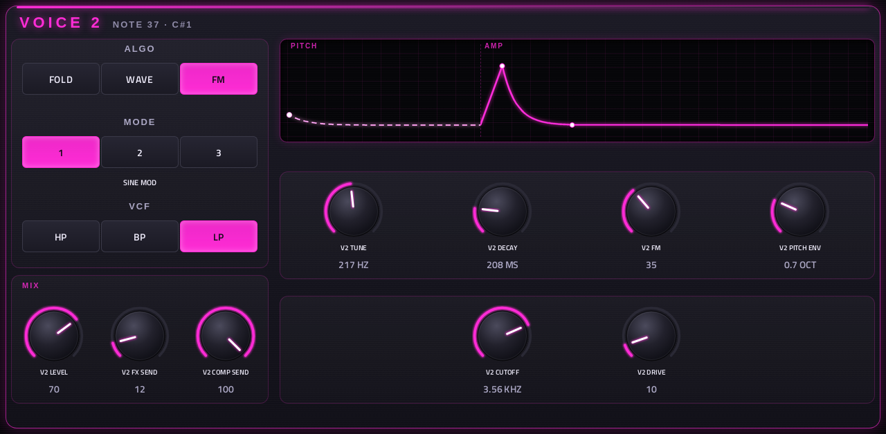
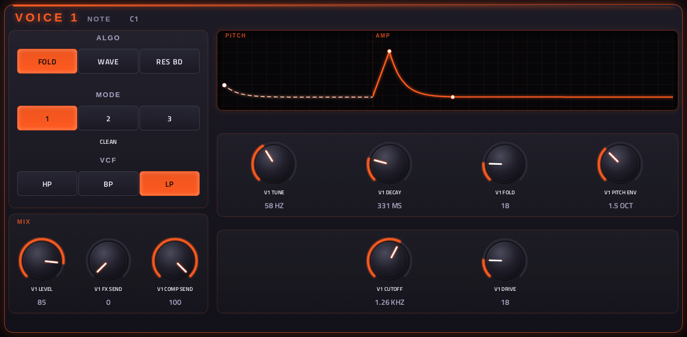
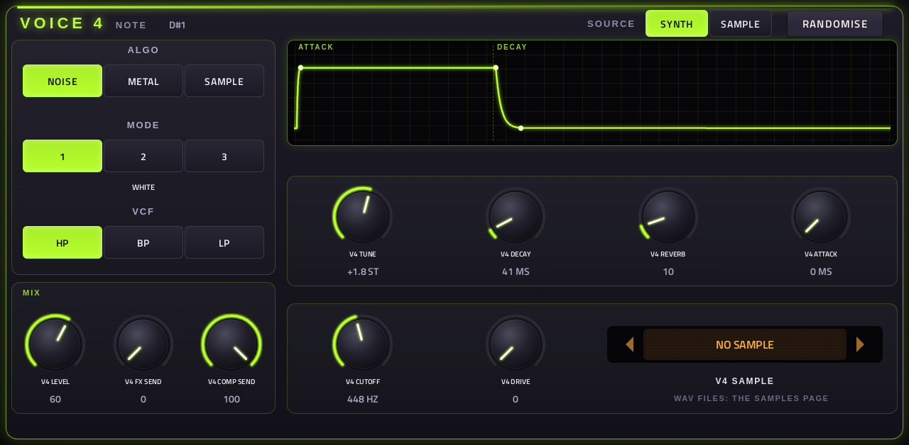
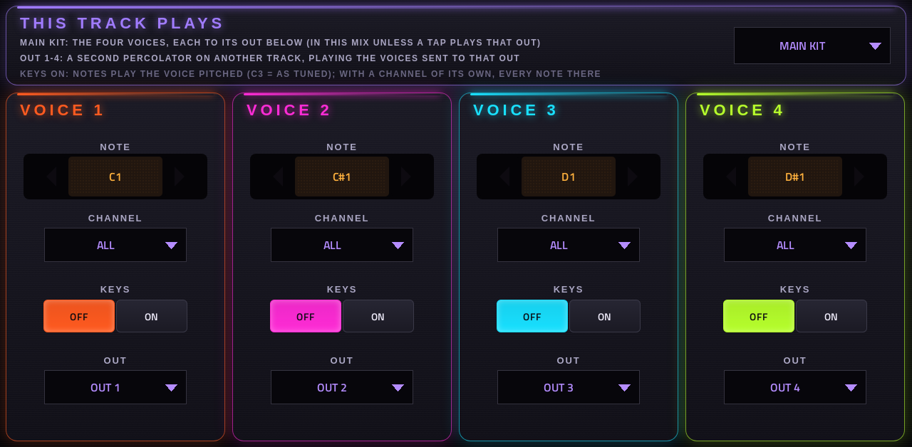
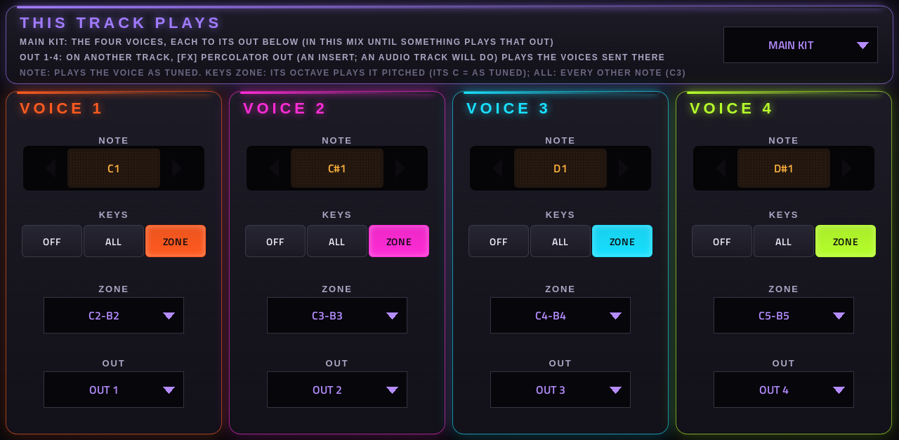

# Percolator

**Drum synth** · Four-voice percussion synth laid out like the Erica Synths Pērkons HD-01, with envelope displays; it plays the Pērkons' free kit packs. · maker in MPC: Steve A · written for this repo · licence: MIT ([`LICENSE`](LICENSE))



The Pērkons HD-01 is a four-voice hybrid drum machine: a digital engine per voice, then an analogue HP/BP/LP filter
and an overdrive, a BBD-style delay, a compressor and one LFO that can reach every knob. Percolator copies that
architecture and its panel (each voice has TUNE, DECAY, PARAM 1, PARAM 2, CUTOFF, DRIVE, FX SEND and LEVEL, plus ALGO,
MODE and VCF switches), and leaves out the sequencer: you play it from MPC's pads and sequencer.

**It is not an emulation.** The Pērkons firmware is a compiled binary for its own chip, and its DSP can't be read out
of it, so every algorithm here is written from scratch. The algorithm and parameter names follow the published
manuals for the HD-01 and the Perkons Voice module. A kit from a Pērkons pack keeps its structure (which algorithm,
which mode, where each knob is, the LFO, the delay), but it won't sound exactly like the hardware.

## On the MPC

- In the plugin browser: **[DRUM] Percolator** by **Steve A** (Drum Machine)
- Files: the release installs one folder, `/sdcard/Synths/Steve A - VST - [DRUM] Percolator/`, holding `percolator.so`, its screen. The vst_instruments installer puts `percolator.so` in `/sdcard/vst/` instead.
- Data folder: `percolator/` next to `percolator.so` (with the vst_instruments installer, `/sdcard/vst/percolator/`):
  where the kit packs go
- 123 parameters (all automatable) on 8 pages, one Q-Link page each
- 8 kits built in, in MPC's PRESET menu; Erica Synths' four free Pērkons kit packs add 169 more ([below](#pērkons-kit-packs))

## Playing it

Each voice's MIDI is set on the **MIDI & OUT** page:

- **NOTE**: the note that plays it, as tuned. To start with **36-39 (C1-D#1)** for voices 1-4, the usual drum notes
  (a Force's drum pads, TR-MPC); on an MPC plugin track those are pads 1-4 of **bank B**. Give two voices the same
  note and they play together. (Up to 1.2.0 the notes were fixed at 20-23, bank A: a sequence recorded on those needs
  moving, or set the NOTEs to G#-1, A-1, A#-1, B-1.)
- **KEYS CH**: the MIDI channel on which every note plays the voice **pitched** (C3 = as tuned), with that channel's
  pitch bend (±2 semitones). To start with **channels 2-5 for voices 1-4**: the Pērkons' MULTI mode, always on. Two
  voices on one KEYS CH play together. **OFF**: never pitched. **ALL**: every note that isn't a voice's NOTE, on any
  channel (the KEYS switch up to 1.2.0; a project saved then gets ALL on its KEYS voice). On its KEYS CH a voice takes
  every note, its own NOTE too; on other channels its NOTE plays it as tuned.

  **The channels come in through Percolator's own MIDI port**, as they would to a hardware Pērkons: MPC hands a plugin
  on its track every note-on on channel 1, whatever channel it was sent on (traced on a Live II), so the track can't
  carry them. Percolator opens a MIDI input port that MPC lists as **Percolator MIDI In** (a second Percolator:
  Percolator 2 MIDI In). To play voice 2 from a MIDI track: that track's **MIDI OUTPUT PORT** = Percolator MIDI In,
  **MIDI OUTPUT CH** = 3. A track per voice, or one track whose notes carry their channels. The pads and the notes on
  Percolator's own track still play the kit (they arrive on channel 1). Don't also route that MIDI track into
  Percolator's track, or each note plays twice.
- Velocity sets the level.
- **DECAY at the top = DRONE**: the voice sounds for as long as its note is held, then fades in 0.35 s (on the
  hardware a drone never stops; here the note length decides).
- CC 120 (all sound off) and 123 (all notes off) stop everything. MIDI CC 20-35 move the first page's (MASTER's) Q-Links, and
  NRPN reaches any parameter (the wrapper's, as in every plugin here).

## The voices

| Voice | ALGO 1 | ALGO 2 | ALGO 3 |
|---|---|---|---|
| **1** (low, 12 Hz-770 Hz) | **FOLD**: sine through a wavefolder. P1 fold, P2 pitch envelope. Modes: clean, noise hit, pulse hit | **WAVE**: wavetable. P1 position, P2 pitch envelope. Modes: analog, formant, digital tables | **RES BD**: a pitched resonator struck like an 808. P1 pitch-envelope time, P2 pitch envelope. Modes: soft, punch, hard |
| **2** (mid, 25 Hz-2.3 kHz) | **FOLD** (as voice 1) | **WAVE** (as voice 1) | **FM**: two operators. P1 FM amount and ratio, P2 pitch envelope. Modes: sine, triangle, square modulator |
| **3** (snare) | **SNARE**: two resonators and filtered noise. P1 noise tone, P2 noise decay. Modes: classic, tight, metallic | **SLAP**: a clap, bursts of band-passed noise and a tail. P1 reverb, P2 filter. Modes: 3, 4 or 5 claps | **TOM**: a resonator with self-FM. P1 FM, P2 tone (click). Modes: flat, drop, deep drop |
| **4** (metal) | **NOISE**: P1 reverb, P2 attack. Modes: white, pulse stack (six square waves, 808 hat), crush | **METAL**: P1 reverb (PCM: size), P2 attack. Modes: cymbal, bell (FM), PCM noise | **SAMPLE**: three slots. P1 crush (sample rate and bits), P2 attack, or start/slice with a pack's samples. Modes: sample 1-3 |

PARAM 1 and PARAM 2 rename themselves on the MPC as the algorithm changes ("V1 FOLD", "V3 NOISE DECAY"), and TUNE,
DECAY, CUTOFF and the time-like params show their real units (Hz, ms, octaves, slice 3 / 8). The selected mode's name shows in
the panel's title bar.

After the engine, every voice has the same end: the filter (HP / BP / LP, 20 Hz-20 kHz, no resonance control, like
the hardware's), the overdrive, then LEVEL, the FX SEND to the delay and the COMP SEND to the compressor.

**Voice 4's samples.** Without a pack, the three slots hold a closed hat, an open hat and a ride, synthesised at
start-up. A pack that comes with `SAMPLES/1.wav 2.wav 3.wav` (Pērkons pack 2 and 4) replaces them for its own kits.
Then PARAM 2 picks the start point or, when the WAV has cue points (pack 4's breaks), the slice. On the Pērkons this
needs two settings (Voice 4 / Algo 3 PARAM 2 = start, slicing on); here it follows from the pack having samples.

## The compressor

Each voice's **COMP SEND** sets how much of it goes through the compressor (wet) and how much goes past it (dry); the
delay's echoes always go past it. 100 (all of it, as before 2.0.0) by default. On the MASTER page, **COMP THRESH**
sets the threshold (0 to -36 dB) and **COMP AMOUNT** the ratio (1:1 to 10:1). AMOUNT at 0 reads **OFF**: the
compressor is bypassed and the kit sounds exactly as without it. Turned up it makes up the level it takes, so it only
ever makes the voices louder: on the eight built-in kits, from +0.3 dB (a little THRESH) to +11 dB (all the way),
with the peaks under -3 dB. It catches a peak at once and lets go over about 120 ms. **COMP LEVEL** sets how much
comes out of it (-inf to +6 dB; 71 = as it is): it turns down only what goes through the compressor, while
**VOLUME** turns down the whole kit. COMP LEVEL does nothing while AMOUNT is OFF, so it can't silence the kit then.
Each voice's own volume is its **LEVEL**, in the MIX panel beside its COMP SEND.

## Separate outputs (OUT 1-4)

MPC plays only a plugin's first stereo pair (sd88me's test on a Force), so a plugin can't send voices to outputs of
their own. Instead, voices can get **a track of their own**: each voice's **OUT** (MIDI & OUT page) sends it to
**MAIN** or to **OUT 1-4** (to start with, voice 1 to OUT 1 and so on), and something on another track plays an OUT:

- **[FX] Percolator OUT** ([its README](../percolatorout/)), an insert effect: put it in any track's insert slot, an
  **audio track** will do, and pick the OUT. It doesn't take an instrument plugin's place and costs next to nothing.
- Or a second Percolator with **TRACK PLAYS** (top of the MIDI & OUT page) = **OUT 1-4**, which also puts its own
  VOLUME and compressor on that OUT (only those do anything there; it ignores MIDI).

Either way, those voices play on that track, with its fader, inserts and outputs, and leave this Percolator's own mix
and compressor; their FX SEND still feeds its delay.

- Until something plays an OUT, the voices sent there stay in the main mix, so nothing goes quiet by accident. A voice
  on **MAIN** never leaves it.
- Several voices can share an OUT (say both hats on OUT 4): their track plays them together.
- Removed or switched away, an OUT's voices come back to the main mix within 16 blocks (46 ms).
- An OUT plays a block (2.9 ms) after the main one would have; while an OUT is played, the main one holds its own
  output back by the same block so they stay together. (If MPC always ran that track before the main one's, it would
  settle two blocks late, one behind the rest; offline both orders and a mix of them work.)
- With two Percolators on MAIN KIT in a project, OUT 1-4 follow the first one that played.
- How it works: OUT 1-4 live in a small shared-memory region every Percolator and Percolator OUT maps when it's
  created (`src/tapbus.h`).

## Pages

Screenshots are rendered from the built skin with the engine's real values right after it's inserted (the Init kit).
Eight tabs, in this order, each with one Q-Link page (no sub-pages to swipe between). Each voice has its own colour: 1 orange,
2 magenta, 3 cyan, 4 lime.

### 1. MASTER



**KIT**: every kit, built-in and loaded, also in MPC's PRESET menu. Choosing the kit that is already loaded changes nothing (MPC sets the current one again on STOP, which must not undo your edits): to go back to a kit as saved, pick another and then it. **BBD DELAY**: time (SHORT 8-200 ms, LONG 60 ms-1.2
s; moving it bends the pitch as a BBD clock would), feedback (it can run away), its own LFO rate and depth, and
COLOUR (dark or bright repeats). **MASTER**: VOLUME (the whole kit), then the COMPRESSOR: THRESH, AMOUNT, LEVEL.
**MODULATION**: the LFO's speed (0.05-30 Hz), MOD LEVEL and wave (sine, triangle, ramp, saw, square, S&H, drift).
Q-Link columns: BBD, MASTER, MODULATION, then KIT.

### 2-5. V1, V2, V3, V4




One voice per page, each Q-Link column on its own panel: **Q-Link column 1** = ALGO, MODE, VCF (the switches, big
enough to tap, and the mode's name under MODE), **column 2** = TUNE, DECAY, PARAM 1, PARAM 2, **column 3** = CUTOFF,
DRIVE, **column 4** = MIX, under the switches: LEVEL (the voice's volume), FX SEND, COMP SEND. Above the knobs, the **envelope display** redraws as you turn its knobs: AMP
follows DECAY (a flat line at the top = DRONE), PITCH (voices 1-2) follows PARAM 2's pitch envelope, voice 4's ATTACK
follows its PARAM 2.

### 6-7. MOD 1+2, MOD 3+4



How far the LFO moves each knob of each voice: OFF or 10 %-80 % (the hardware's MODULATION DESTINATION / DEPTH
buttons), in the voice pages' order (TUNE DECAY PARAM 1 PARAM 2 / CUTOFF DRIVE FX SEND LEVEL), with the LFO's wave, speed and MOD LEVEL shown live above
(MOD LEVEL scales them all).

### 8. MIDI & OUT



What this track plays (TRACK PLAYS: MAIN KIT, or OUT 1-4 of the main Percolator, [above](#separate-outputs-out-1-4)),
then a panel per voice, each a Q-Link column: NOTE (arrows, or turn its Q-Link), KEYS CH and OUT
([Playing it](#playing-it)).

## Kits

**Built in (8):** Init, Analog, Industrial, Clap Room, Tonal, Lo-Fi, Drone, Thunder.

### Pērkons kit packs

Erica Synths gives away four kit packs for the Pērkons, 169 kits in all. They aren't shipped with Percolator (they're
Erica's and their authors', and come without a licence to pass them on), but it reads them as they are: download,
unzip, copy the folder in.

| Pack | Kits | Download (Erica Synths) |
|---|---|---|
| Kit Pack 1 by Hrtl (2023) | 32: drums, bonks, polys, SFX | [Perkons_Kit_Pack_01_GuSQDTL1.zip](https://www.ericasynths.lv/service/file/download/product_id/1167/file_id/525/) (27 KB) |
| Kit Pack 2 by Hrtl (2025) | 32, and three samples for voice 4 | [PERKONS_KIT_PACK_2_kfMSLW4.zip](https://www.ericasynths.lv/service/file/download/product_id/1167/file_id/584/) (3 MB) |
| Kit Pack 3 by Pijus Džiugas Meižis (2025) | 59 (drones, sequences, chains) | [PERKONS_KIT_PACK_3.zip](https://www.ericasynths.lv/service/file/download/product_id/1167/file_id/616/) (3.8 MB) |
| Kit Pack 4 by Fat Frumos (2026) | 46 from the Thunder Cats EP, with sliced breaks | [PERKONS_KIT_PACK_4.zip](https://www.ericasynths.lv/service/file/download/product_id/1167/file_id/660/) (8 MB) |

The links are the Downloads on Erica's [Pērkons HD-01 page](https://www.ericasynths.lv/perkons-hd-01-black-2520/)
(checked 2026-10-10); if one moves, the page has them.

**To add them:**

1. Download the zips and unzip them on your computer. Each gives one folder (`Perkons Kit Pack 01`,
   `PERKONS KIT PACK 2`, ...). Leave its insides as they are; the `__MACOSX` folder and `.jpg`/`.png` files can go.
2. Copy those folders into Percolator's data folder on the MPC:
   - installed from this plugin's release: `/sdcard/Synths/Steve A - VST - [DRUM] Percolator/percolator/`
   - installed with vst_instruments' `install.sh`: `/sdcard/vst/percolator/`

   For example over SSH (as root, as for installing), from the folder you unzipped into; the first line makes the
   folder if it isn't there yet:
   ```
   ssh root@<mpc-address> 'mkdir -p "/sdcard/vst/percolator"'
   scp -r "PERKONS KIT PACK 2" root@<mpc-address>:"/sdcard/vst/percolator/"
   ```
   (for the release, the path in quotes is `/sdcard/Synths/Steve A - VST - [DRUM] Percolator/percolator`)
3. Remove Percolator from its track and insert it again (it reads the kits when it's inserted). The kits are in
   MPC's PRESET menu and on the MASTER page's KIT, after the built-in ones, as **Pack 1 01**, **Pack 2 05** and so on.

Updating or uninstalling the release keeps what you added in `percolator/`.

Notes on the packs:
- **Pack 2 and Pack 4** bring their own samples for voice 4's SAMPLE algorithm (they replace the built-in hats for
  that pack's kits). With Pack 4's, PARAM 2 picks a slice of the break (its WAVs carry slice markers).
- **Pack 3**: some kits have every LEVEL at 0 on purpose: Pijus's patterns bring the voices in with per-step
  automation, which a kit alone doesn't carry. Turn the LEVELs up, or sequence them.
- Only the kits are read: the packs' patterns (`.PAT`) are for the Pērkons' own sequencer.
- **Your own names:** a `names.txt` in a bank's folder (next to its `KITS/`) names its kits, one `NN Name` per line,
  e.g. `05 Dub Chord` lists kit 05 as "Pack 2 Dub Chord".

**Folders it reads** (in its data folder), so you can also lay kits out yourself:

```
<pack>/BANKS/NN/KITS/*.KIT   a pack as it unzips (2, 3) or a Pērkons SD card copied as it is
<pack>/NN/KITS/*.KIT         a pack as it unzips (1, 4)
<pack>/SAMPLES/1.wav 2.wav 3.wav   that pack's samples for voice 4 (16-bit WAV; cue points = slices)
<bank>/KITS/*.KIT            a bank of your own, listed as "<bank> NN" (its samples in <bank>/SAMPLES)
BANKS/NN/KITS/*.KIT          a whole Pērkons SD card copied into the data folder
```

What a kit file holds (protobuf, worked out from the packs; see `src/kits.c`): per voice the eight knobs (16 bits),
algorithm, mode and filter; the LFO's speed, wave and level, and a depth per knob; and, when the kit saved its FX,
the delay's time, feedback, LFO rate, depth and range. A kit without FX leaves the delay as it is (the hardware's
KIT FX off). Not read: patterns (`.PAT`), the sequencer, accent, the master volume and compressor.

## Install

Needs a standalone MPC or Force on MPC OS 3.x with root SSH access (checked on an MPC Live II).

**From the release:** download `DRUM-Percolator-<version>-mpc-armv7.zip` from [Releases](https://github.com/saustin2010/mpc-vst-percolator/releases),
copy it to the MPC, unzip it and run `sh install.sh` in its folder as root. The installer stops MPC, backs up
`MPC.settings`, installs the plugin folder and starts MPC again; `INSTALL.md` in the zip has the details and a by-hand route.
Your own files in `percolator/` are kept when you update or uninstall.

**With the rest of the collection:** from [vst_instruments](https://github.com/saustin2010/vst_instruments) ([INSTALL.md](https://github.com/saustin2010/vst_instruments/blob/main/INSTALL.md)):

```
./install.sh <mpc-address> percolator
```

Use one or the other for this plugin: both register the same plugin (same uid), so the last one run wins.

## How it's made

- `src/percolator.c`: parameters, MIDI, the LFO, the BBD delay, compressor, voice taps and state; `src/voices.c`: the twelve
  algorithms and each voice's filter, drive and level; `src/kits.c`: the built-in kits, the `.KIT` reader, WAV and
  cue loading; `src/dsp.h`. The engine is plain C (`mpc_engine` API), with no upstream code.
- `mpc/gen.py` writes `params.json`, `src/params_def.h`, `layout.conf` and `build/skin.json` from one list
  (parameters are append-only). `mpc/skin.py` draws the artwork from that in the `mpc-vst-html-art` container (page
  backgrounds from HTML, a knob filmstrip per colour, the switch segments), and `mpc/displays.py` the envelope
  displays (one frame per knob position, so nothing animates). Change those, not their output:
  ```
  python3 mpc/gen.py
  docker run --rm -v "$PWD:$PWD" -w "$PWD" mpc-vst-html-art python3 mpc/skin.py build/skin.json
  ```
- `mpc/render.c` renders kits offline to WAV (each voice alone, then a groove), no MPC needed:
  ```
  cc -O2 -Isrc mpc/render.c src/percolator.c src/voices.c src/kits.c -lm -lpthread -o build/render
  build/render <data folder> build/demo [kit numbers]
  ```
- Sources for the design: [Sound On Sound's HD-01 review](https://www.soundonsound.com/reviews/erica-synths-perkons-hd-01),
  the [Perkons Voice manual](https://www.analoguehaven.com/erica-synths/perkons-voice/manual.pdf) (its algorithm
  table) and the [HD-01 manual](https://www.manualslib.com/manual/2588218/Erica-Synths-Perkons-Hd-01.html). The kit
  format was worked out from the packs themselves.

## Status (2026-10-12)

- Build and offline host test PASSED (ARM `.so`, the x86 test under ASan/UBSan with the four packs mounted: two
  instances, every parameter, Q-Links, pop-ups, CC and NRPN, chunk restore, 177 kits named in the PRESET menu);
  `check_skin.py`: OK. Every algorithm and mode measured offline (level, DC, clicks).
- On an MPC Live II (as "Perculator", the first screen): `bench.sh` idle 1.1 %, playing 1.9 %, Q-Link sweep p99 4.0 %,
  worst block 4.3 %: PASS.
- Released v1.0.0 to v1.2.0 (2026-10-10; 1.0.1: the MOD pages' captions clear of MPC's Q-Link badge; 1.2.0: below) from
  [mpc-vst-percolator](https://github.com/saustin2010/mpc-vst-percolator), proposed to
  [sd88me's catalogue](https://sd88me.github.io/mpc-vst-plugins/) (sd88me/mpc-vst-plugins#255). The release zips'
  screens are byte-identical to `deploy/`.
- On the Live II (2026-10-10, this repo's build): all pages, the Q-Links, the envelope displays following their
  knobs, and the four kit packs: "all good". Then (owner): the switches were clunky to tap and off the Q-Links, and
  pressing STOP reset the knobs. 1.1.0: one voice per page with its switches on Q-Link column 1. A device trace then
  showed why STOP reset them: on every STOP (and on insert) MPC's host sets parameter 0, KIT, to its top and straight
  back, and each set loaded a kit. 1.2.0: a kit set waits for the next block, so that pair loads nothing; and MODE
  steps on its Q-Link (its 1/2/3 labels had clashed with the value the engine reports). Both confirmed on the Live II.
- 2.0.0, not yet released (2026-10-12): a MIDI & OUT page: each voice's NOTE (36-39 to start with; they were fixed
  at 20-23), KEYS CH (channels 2-5 play voices 1-4 pitched: the Pērkons' MULTI, through Percolator MIDI In) and OUT (MAIN, OUT 1-4, played on
  another track by [FX] Percolator OUT or a second Percolator); COMP SEND per voice, the compressor bypassed at AMOUNT 0 and only ever louder above it (it was half made up, so
  a high THRESH made the kit up to 6.6 dB quieter), and COMP LEVEL, its own output; each voice's LEVEL, FX SEND and
  COMP SEND in a MIX panel (Q-Link column 4).
  Offline: build and host test PASSED, `check_skin.py` OK; AMOUNT 0 is the old engine to 1 LSB over 1.4M frames; every
  THRESH x AMOUNT louder than off on the built-in kits; the MIDI routing (22 cases, MPC's note-offs among them); OUT
  1-4 in one process in either order, random order and on two threads with jitter (every block is the voices sent
  there alone; main + OUT = the kit), two voices on one OUT, a voice kept on MAIN.
  On the Live II (owner, 2026-10-12, after the notes, an OUT on an audio track, the compressor and the timing): "ok
  all works", but not the channels. A trace build showed why: a MIDI track on channel 3, routed into Percolator's
  track, reached the plugin as note-ons on channel 1 (`90 41 7f`) and note-offs on 3 (`82 41 40`). A note-off now
  ends its note on any channel (a drone played from a MIDI track had never stopped). Zones (KEYS OFF / ALL / an
  octave per voice) were tried and turned down by the owner ("it should be all keys fired from the midi channel"), so
  Percolator now opens its own MIDI input port, Percolator MIDI In, for the channels (`src/midiin.h`; libasound
  dlopen()ed, the build needs only libc, like Stevequencer). On the Live II (owner, 2026-10-12): a MIDI track with
  MIDI OUTPUT PORT = Percolator MIDI In plays each voice on its channel: "this is working!"

## Files

| Path | What |
|---|---|
| `screenshots/` | the pages as MPC draws them |
| `.github/workflows/release.yml` | the release build (GitHub Actions, a draft release) |
| `FRAMEWORK.md` | the changes to sd88me's tools this plugin is built with, and why |
| `deploy/` | ready to install: `vst/` → `/sdcard/vst/`, `Synths/` → `/sdcard/Synths/`, plus the plugin-list entry |
| `vst.json` | build settings: name, maker, sources, the kit list in the PRESET menu |
| `params.json` | the plugin's parameters as MPC sees them (VST index = order; append-only once released) |
| `layout.conf` | the screen: eight pages, Q-Links (generated) |
| `percolator.css` | the artwork stylesheet |
| `images/skin/` | artwork: page backgrounds, knob filmstrips, switch segments, envelope displays (generated) |
| `src/`, `mpc/` | the engine, the generators, the offline renderer |

## Building

With Docker (32-bit ARM emulation for the build), Python 3 and the tools from
[saustin2010/mpc-vst-plugins](https://github.com/saustin2010/mpc-vst-plugins/tree/steve-features) (sd88me's [mpc-vst-plugins](https://github.com/sd88me/mpc-vst-plugins)
plus changes offered to it, until they're merged there; the commit is the one in `.github/workflows/release.yml`, and [FRAMEWORK.md](FRAMEWORK.md) says which changes this plugin uses and why):

```
git clone -b steve-features https://github.com/saustin2010/mpc-vst-plugins
MPC_VST=$PWD/mpc-vst-plugins
bash "$MPC_VST/tools/build_port.sh" vst.json        # build/: percolator.so, the screen, the plugin-list entry
bash "$MPC_VST/tools/test_port.sh" vst.json         # the offline host test (ASan/UBSan): must print PASSED
```

Releases are built by GitHub Actions (`.github/workflows/release.yml`, "Release (draft)") as a draft, installed and checked
on a device, then published. More: [BUILDING.md](https://github.com/saustin2010/vst_instruments/blob/main/BUILDING.md), and to change the screen, [RESKINNING.md](https://github.com/saustin2010/vst_instruments/blob/main/RESKINNING.md).

## Development

This plugin is developed in [vst_instruments](https://github.com/saustin2010/vst_instruments) (`originals/percolator`), next to the other plugins
and the tools that made its screen, and published to [mpc-vst-percolator](https://github.com/saustin2010/mpc-vst-percolator) for its
releases. Issues and pull requests are welcome in either.
