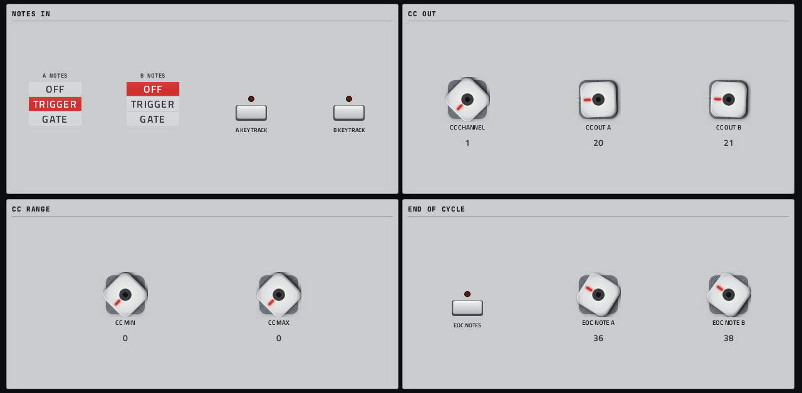

# Dual Slope

**Modulator** · Dual Slope: two rise-and-fall generators (envelopes, LFOs, slew) that modulate other tracks, based on Befaco's Rampage VCV Rack module. · maker in MPC: Andrew Belt · licence: GPL-3.0


Formerly **Rampage**, renamed on 2026-10-13: Rampage is Befaco's module (only its VCV Rack code is open source), so the plugin has a name of its own and Andrew Belt of VCV as its maker. Its sound is VCV's open-source Rack code for Befaco's Rampage (© VCV and contributors), unchanged.

Dual Slope is a dual function generator, after Befaco's Rampage: two channels that each make a rise and a fall, with adjustable times, shapes and range. Triggered they're envelopes, gated they hold (attack-sustain-release), cycling they're LFOs, and BALANCE and the MIN/MAX outputs combine both channels. On the MPC, notes on its track trigger or gate each channel, and OUT A/B, MIN and MAX go out of its own MIDI port as CCs you can MIDI-learn on another track; end-of-cycle events go out as notes. Turn AUDIO on to hear the outputs. Ported unchanged from the VCV Rack code for Befaco's module through a small Rack API stand-in.

## On the MPC

- In the plugin browser: **[SEQ] Dual Slope** by **Andrew Belt** (Sequencer)
- Files: the release installs one folder, `/sdcard/Synths/Andrew Belt - VST - [SEQ] Dual Slope/`, holding `rampage.so`, its screen. The vst_instruments installer puts `rampage.so` in `/sdcard/vst/` instead.
- 27 parameters (all automatable) on 2 pages

## Playing it

The walk-through, with what to check when nothing plays: [docs/sequencers.md](https://github.com/saustin2010/vst_instruments/blob/main/docs/sequencers.md).

MPC OS ignores a plugin's own MIDI output, so Dual Slope opens its own MIDI port (MPC lists it as **[SEQ] Dual Slope MIDI Out**; **[SEQ] Rampage MIDI Out** before the rename, so turn **Track** on for the new one), the way a USB MIDI device would appear. MPC picks the port up without a restart:

1. Put Dual Slope on a plugin track and play or hold notes into it (pads, keys or a MIDI clip).
2. **Menu → Preferences → MIDI**: switch **Track** on for **[SEQ] Dual Slope MIDI Out**.
3. On the track to modulate, set **MIDI Input Port** to that port (with **Monitor** on **In**). On this repo's instruments, CC 20-35 move the first page's Q-Links (CC 20-23 = the first column, top to bottom, and so on), so CC OUT A and CC OUT B (MIDI page; 20 and 21 by default) move the first two knobs straight away, no MIDI learn. MIN and MAX send too when given a CC number. Learning Dual Slope's CCs in MPC's MIDI Learn isn't recommended: with the port's Remote switched on, its stream of CCs froze MPC once (2026-10-04).
4. EOC NOTES sends a short note at the end of each cycle, e.g. to fire a drum pad on another track.

Dual Slope makes no sound of its own unless AUDIO is on.

## Pages

Screenshots are rendered from the built skin with the engine's real values right after it's inserted. On the MPC each page is a tab under the plugin header. The Q-Links follow the page column by column: on a 4-knob MPC the Q-Link button steps through the columns, and MPC outlines the active one.

### 1. DUAL SLOPE


Q-Link columns: **1** A RANGE, A RISE, A FALL, A SHAPE  ·  **2** B RANGE, B RISE, B FALL, B SHAPE  ·  **3** CYCLE A, BALANCE, CYCLE B  ·  **4** AUDIO, VOLUME

### 2. MIDI



Q-Link columns: **1** A NOTES, B NOTES, A KEY TRACK, B KEY TRACK  ·  **2** CC CHANNEL, CC OUT A, CC OUT B  ·  **3** CC MIN, CC MAX  ·  **4** EOC NOTES, EOC NOTE A, EOC NOTE B

## Install

Needs a standalone MPC or Force on MPC OS 3.x with root SSH access (checked on an MPC Live II).

**From the release:** download `SEQ-Dual-Slope-<version>-mpc-armv7.zip` from [Releases](https://github.com/saustin2010/mpc-vst-dual-slope/releases),
copy it to the MPC, unzip it and run `sh install.sh` in its folder as root. The installer stops MPC, backs up
`MPC.settings`, installs the plugin folder and starts MPC again; `INSTALL.md` in the zip has the details and a by-hand route.

**With the rest of the collection:** from [vst_instruments](https://github.com/saustin2010/vst_instruments) ([INSTALL.md](https://github.com/saustin2010/vst_instruments/blob/main/INSTALL.md)):

```
./install.sh <mpc-address> rampage
```

Use one or the other for this plugin: both register the same plugin (same uid), so the last one run wins.

## Where it comes from

- Upstream: https://github.com/VCVRack/Befaco (src/Rampage.cpp, src/plugin.hpp)
- Vendored at commit bf03788cf11668ba4d371291d6b6dc8377393a24 2026-09-17
- Licence: GPL-3.0 ([`LICENSE`](LICENSE), [`LICENSE.md`](LICENSE.md), [`LICENSE-GPLv3.txt`](LICENSE-GPLv3.txt))
- MPC port and screen: [vst_instruments](https://github.com/saustin2010/vst_instruments) (`vcv-rack/rampage`), built on [sd88me's mpc-vst-plugins](https://github.com/sd88me/mpc-vst-plugins) (wrapper, Schwung adapter, skin tools).

## Changes for the MPC

- Not a Move module: Befaco's Rampage from VCVRack/Befaco (VCV's open-source Rack code). `src/Rampage_dsp.hpp` is its module code without the panel widget, unchanged (`dev-tools/rack/extract_module.py`), compiled against `dev-tools/rack/rack_shim.hpp`, a small portable stand-in for the Rack API (Module, ports, float_4).
- `mpc/rampage_engine.cc`: MIDI notes trigger (AR) or gate (ASR) each channel, KEY TRACK drives EXP CV; OUT A/B, MIN and MAX go out as MIDI CC through the plugin's own port (`dev-tools/midiout`), end-of-cycle as notes; AUDIO plays OUT A/B (DC-blocked). Turning CYCLE on kicks the loop once (the module only re-fires at a cycle's end).
- New touchscreen page from its Google Stitch design (`design/`): the design's artwork as the background, its own knob art, live names and values, and controls the design left out added in its style (see RESKINNING.md).
- **Full-height screen (2026-10-18)**: the panels fill MPC's 1280 × 628 plugin area. The Stitch conversion used to
  centre the design at the height it had under its own header and footer (MPC draws its own), which left an empty
  band above and below.

## Files

| Path | What |
|---|---|
| `screenshots/` | the pages as MPC draws them |
| `.github/workflows/release.yml` | the release build (GitHub Actions, a draft release) |
| `FRAMEWORK.md` | the changes to sd88me's tools this plugin is built with, and why |
| `tested.json` | the devices each release was checked on (the catalogue shows it) |
| `deploy/` | ready to install: `vst/` → `/sdcard/vst/`, `Synths/` → `/sdcard/Synths/`, plus the plugin-list entry (not used by the release) |
| `vst.json` | build settings: name, maker, sources, compiler flags |
| `params.json` | the plugin's parameters as MPC sees them (VST index = order) |
| `params.base.json` | the engine's own parameter list it was derived from |
| `params.pre-stitch.json` | the parameter list before the Stitch screen renamed controls |
| `layout.conf` | the screen: control positions, art, Q-Links (generated from the Stitch design) |
| `layout.grid.conf` | the plan of pages and controls the Stitch conversion fills in |
| `rampage.css` | the artwork stylesheet |
| `images/` | artwork: backgrounds, knobs, displays |
| `design/` | the Google Stitch design this screen was converted from (`stitch.html`, as Stitch wrote it) |
| `src/` | the engine's source, vendored from upstream |
| `mpc/` | MPC-side glue: the engine wrapper or MIDI/audio adapter, and headers |
| `UPSTREAM` | where the source came from, and at which commit |

## Building

With Docker (32-bit ARM emulation for the build), Python 3 and the tools from
[saustin2010/mpc-vst-plugins](https://github.com/saustin2010/mpc-vst-plugins/tree/steve-features) (sd88me's [mpc-vst-plugins](https://github.com/sd88me/mpc-vst-plugins)
plus changes offered to it, until they're merged there; the commit is the one in `.github/workflows/release.yml`, and [FRAMEWORK.md](FRAMEWORK.md) says which changes this plugin uses and why):

```
git clone -b steve-features https://github.com/saustin2010/mpc-vst-plugins
MPC_VST=$PWD/mpc-vst-plugins
bash "$MPC_VST/tools/build_port.sh" vst.json        # build/: rampage.so, the screen, the plugin-list entry
bash "$MPC_VST/tools/test_port.sh" vst.json         # the offline host test (ASan/UBSan): must print PASSED
```

Releases are built by GitHub Actions (`.github/workflows/release.yml`, "Release (draft)") as a draft, installed and checked
on a device, then published. More: [BUILDING.md](https://github.com/saustin2010/vst_instruments/blob/main/BUILDING.md), and to change the screen, [RESKINNING.md](https://github.com/saustin2010/vst_instruments/blob/main/RESKINNING.md).

## Development

This plugin is developed in [vst_instruments](https://github.com/saustin2010/vst_instruments) (`vcv-rack/rampage`), next to the other plugins
and the tools that made its screen, and published to [mpc-vst-rampage](https://github.com/saustin2010/mpc-vst-rampage) for its
releases. Issues and pull requests are welcome in either.
